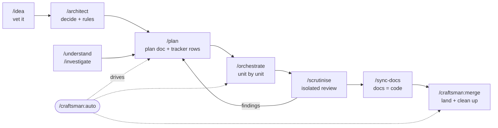

# craftsman

**v2.3.1** — see [CHANGELOG.md](CHANGELOG.md) for what changed.

A Claude Code plugin that makes code better automatically, in **any language**.
It runs your formatters, linters and type-checkers on every edit and reports
only the issues *you* introduce. It won't let a task count as "done" if the
tests broke, a secret leaked or a plan criterion is still open. On top of that
it adds a doc-first workflow (idea → architecture → plan → build → review →
docs → merge) that can run unattended, with guards that keep it inside the
lines.

Drop it into a Python, Go, Rust, Java, Ruby, JS/TS, C#, Swift, Kotlin, PHP,
C++, Terraform or Kubernetes repo and run `/craftsman:init`. It detects your
stack and configures itself. It is dependency-free: Node only, which ships with
Claude Code.

**Contents:** [Quick start](#quick-start) · [How it works](#how-it-works) ·
[Features](#features) · [Commands](#commands) · [Configure it](#configure-it-for-your-stack) ·
[Full update](#full-update-taking-every-change-and-its-knock-on-changes) ·
[Good to know](#good-to-know) · [Safety](#safety) · [Layout](#layout)

---

## What's new in 2.3.1

- **Automatic archive hardened.** The in-process landing capability can be
  obtained only through one function and a wiring test limits who names it.
  Injected test seams get a marker the real `retire` refuses, and a landing
  retire with no archive project refuses before removing anything.
- **Unit merges respect approval.** With the approval gate on, a unit merge to
  base needs your approval too.
- **Claims and the unit runner.** Claims anchor at the main checkout, and the
  runner's helper runs from the project root so workspace mode resolves it.
- **UI gate.** It routes to the Artist agent or an accessibility fallback.

The full list is in [CHANGELOG.md](CHANGELOG.md#231---2026-10-25).

## What's new in 2.3.0

- **Approval before base.** With `planning.featureBranches` on, a run stops at
  one private page (Merge now / Open PR) and lands only on your own checked
  click. Headless runs fall back to Markdown and one terminal question.
- **Guards fail closed.** Every hook runs through `hooks/run.sh`. Only
  `CRAFTSMAN_SAFETY=off` in your own environment turns the safety guards off,
  and the model cannot switch them off.
- **Evidence-based worktree sweep.** A branch counts as merged only into a
  remote-tracking ref, and every deleted branch is logged and recoverable.
- **Dashboard, notes export and archive.** `/digest --html`, an
  Obsidian/Foam/Quartz notes folder, and automatic archiving of closed plans
  through an in-process landing capability.
- **Ledger guard, measurement and tool slots.** Tracker publishing never drops
  a committed row. Per-session context is measured, and `just check` leads the
  stop-gate commands.
- **Docs.** This README now explains how craftsman works and gives a
  step-by-step [full update](#full-update-taking-every-change-and-its-knock-on-changes).

The full list is in [CHANGELOG.md](CHANGELOG.md#230---2026-10-25).

---

## Quick start

```text
# 1 — install  (from GitHub once published; see PUBLISH.md)
/plugin marketplace add plantgreytrees/craftsman
/plugin install craftsman@craftsman-marketplace

# 2 — restart Claude Code so the hooks load, then in your repo:
/craftsman:init        # audit, upgrade older setup, and repair required structure
/craftsman:baseline    # snapshot existing lint issues so only NEW ones get flagged
```

That's the whole setup. To install from a local folder instead of GitHub, use
`/plugin marketplace add /absolute/path/to/craftsman`. The full walkthrough and
troubleshooting are in **[INSTALL.md](INSTALL.md)**.

A first piece of work then looks like this:

```text
/craftsman:auto add rate limiting to the public API
```

`/auto` asks its open questions up front, plans the work, builds each unit in
its own worktree with gates and reviews, asks once more about anything that
came back, and lands the result.

---

## How it works

Craftsman is three things working together: **hooks** that run on every tool
call, a set of **commands and agents** that make up the workflow, and **state
on disk** that both of them read and write.

### 1. Hooks: the part that runs itself

Claude Code calls craftsman's hooks at fixed points in every session
(`hooks/hooks.json`). Every hook goes through one launcher, `hooks/run.sh`,
which fails closed for the safety hooks.

| When | Hook | What it does |
|---|---|---|
| Session start | `session-context`, `tracker-sync` | states that the guards are on, names unlanded approvals, restores the last hand-off, re-renders the tracker |
| Before Read/Glob/Grep/Write/Edit/Bash | `pre-guard` | protected paths, unit scope, doc-write authority, tracker block, hook-bypass flags, force-push and other git rules |
| Before Task/Agent/Workflow | `agent-mode-guard` | enforces root-only agent mode and its named exceptions |
| Before Skill | `builtin-skill-context` | hands the built-in `simplify` / `code-review` skills the governing rules and open criteria |
| After Write/Edit | `quality-gate` | format → lint → type-check the edited file; feeds new issues back to Claude mid-turn |
| After Bash/Write/Edit | `tracker-sync` | re-renders `TRACKER.md` from the ledger |
| Prompt submit, after Skill | `orchestrate-scope-guard` | binds a running `/orchestrate` to its plan unit |
| Stop | `stop-gate`, `tracker-sync`, `telemetry` | secrets scan, test-regression check, `extraChecks`, open acceptance criteria, unpushed-work report, gate telemetry |
| Session end | `session-end` | unpushed-work report and hand-off |

### 2. The quality engine: three layers, cheapest first

Each layer does only what the one below it can't:

| Layer | What happens | Cost |
|---|---|---|
| Deterministic | on every edit: format → lint → type-check. At "done": secrets scan + test-regression check, skipped when nothing changed since the last check. **Only newly introduced issues are reported.** | ~free |
| Feedback | when a check fails, its output is fed straight back to Claude mid-turn to fix | ~free |
| Judgment | LLM review (correctness, security, house-style conformance, plan soundness) runs *only* where linters are structurally blind, and only when a cheap router says the diff is worth it | gated |

Every check is a config entry that **silently skips if its tool isn't
installed**. So the same plugin lints Python with `ruff`, Go with
`staticcheck` and Rust with `clippy`, wherever those tools exist. Adding a
language is a one-block config edit, never a code change.

### 3. The workflow: a doc-first loop



- **One slug** names the work from idea doc to plan, fix round and sync.
- **`/idea`** checks a new idea for overlap and whole-system fit, then has it
  judged by one isolated critic. The result is a scored verdict in
  `docs/ideas/`.
- **`/architect`** turns a vetted idea into decisions you confirm. Each area is
  written as a pair: `<area>.md` for people and `<area>.rules.md`, a list of
  numbered `ARCH-…` rules the loop enforces.
- **`/plan`** writes the only plan docs (`docs/plans/<slug>.md`). Each unit
  gets scope, acceptance criteria, cited rules and a tooling manifest.
- **`/orchestrate`** executes a plan one unit at a time, each in its own git
  worktree. `gate-select.mjs` reads the unit's *actual diff* and routes it to
  the specialists that apply: `security-auditor`, the ui gate (`ui-gate.mjs`:
  Artist when present, else the `ui-ux-reviewer` accessibility floor),
  `migration-reviewer`, `api-reviewer`, `dependency-auditor`,
  `performance-reviewer`, `observability-reviewer`. It doesn't rely on anyone
  remembering a file-pattern rule.
- **`/scrutinise`** sends one fresh-context reviewer to audit the merged work
  against every open criterion. Its findings become the next plan round.
- **`/sync-docs`** reconciles docs and tracker chips with shipped code.
  **`/craftsman:merge`** lands the branch and cleans up.
- **`/craftsman:auto`** is the single entry for the whole loop. It asks every
  open decision first, runs the units unattended in fresh agent contexts, asks
  about parked rows, and lands the result. It repeats until every row is
  COMPLETE.
- **`/instruction`** packs the same loop into one paste-ready `/goal` prompt
  with a size estimate.

### 4. State on disk

| Where | What | Committed? |
|---|---|---|
| `craftsman.config.json` (+ optional `craftsman.project.json`) | your overrides, deep-merged over the plugin defaults | yes |
| `docs/ideas/`, `docs/architecture/`, `docs/plans/` | idea verdicts, decisions + rules, plan docs | yes |
| `docs/plans/TRACKER.md`, `TRACKER-archive.md` | the readable tracker and retired rows | yes |
| `docs/errors/KNOWN_ISSUES.md` | pre-existing lint debt, written by `/craftsman:baseline` | yes |
| `.craftsman/tracker/events.jsonl` | the validated tracker ledger (source of truth for status) | no |
| `.craftsman/sessions/<id>/` | per-session baseline, criteria and doc authority | no |
| `.craftsman/claims/`, `runs/`, `approvals/`, `instructions/` | unit claims, run manifests, pending approvals, `/goal` files | no |
| `.craftsman/events.jsonl`, `sweep-log.jsonl` | gate telemetry for `/craftsman:stats`, deleted-branch log | no |

---

## Features

**Only your issues are flagged.** `/craftsman:baseline` snapshots existing
findings, so the gate reports only what *you* introduce. It also writes what it
skipped to `docs/errors/KNOWN_ISSUES.md` (worst file first, regenerated on
every run). A legacy repo's debt stays visible instead of living only in a
gitignored snapshot.

**"Done" is a contract.** The Stop gate blocks completion on a failed secrets
scan, a test regression or an unticked acceptance criterion of a plan the
session worked. Criteria are written at plan time and enforced before a task
can finish.

**Architecture is enforced, not just written down.** `/plan` cites the rules
for each unit, and `plan-reviewer` and the scrutineer check them. `scope.mjs`
refuses to activate a unit that writes a governed path until it has loaded and
cited the rules for that path. Breaking a decided rule takes `/architect`,
never a workaround.

**Unattended runs that stay light.** `/craftsman:auto` runs each unit in a
fresh agent context (`execution.engine`: `workflow` by default, else
`subagent` or `root`). Every unit ends in a hand-off on disk, so auto-compact
never loses the thread. `/plan` refuses a unit too large for one fresh agent
(`execution.unitContextBytes`).

**One approval page.** With `planning.featureBranches` on, a run stops at a
verification point: a private claude.ai page shows what changed, env keys
touched, evidence, risk and rollback, with **Merge now** / **Open PR** buttons.
Only your own click, re-read and checked against the feature head, lands it.
Headless runs fall back to a Markdown page and one terminal question.

**Concurrent sessions are safe.** Session state is isolated, each unit runs in
its own worktree, and the tracker lives in the main checkout so every session
sees one board. Stale claims from crashed sessions are recoverable.

**Progress you can read.** `/craftsman:digest` gives done / decisions needed /
next / % complete per plan. `/digest --html` renders a local dashboard, and
the notes export produces an Obsidian/Foam/Quartz folder. `/craftsman:stats`
shows which gates actually fire, so you can delete the ones that don't earn
their keep.

**Built-in skills, craftsman's rules.** `/orchestrate` runs Claude Code's own
`simplify` and `code-review` skills inside the loop. Their output is only a
candidate list: `code-reviewer` owns the verdict.

**Safety guards that fail closed.** See [Safety](#safety).

---

## Commands

| Command | What it's for |
|---|---|
| `/craftsman:init` | audit or upgrade the setup, detect the stack, and repair the required project structure (`--check`, `--diff`, `--write`, `--update`, `--settings-diff`) |
| `/craftsman:upgrade` | update every Craftsman install (user and per-project) to the latest commit, then tell you what to reload and re-init (`--dry-run`) |
| `/craftsman:workspace-init` | explicitly register selected existing Git projects without scanning the workspace |
| `/idea` | scrutinise an idea before building it: overlap scan, whole-system fit, research, one isolated critic, scored verdict (`--deep` for a stronger critic) |
| `/architect` | turn a vetted idea into confirmed engineering, data and systems decisions, written as enforced architecture docs (`--deep`, `--init`, `--update`; `--backfill` derives them for a project with existing plans and legacy docs) |
| `/craftsman:auto` | one entry for the whole loop: ask every open decision first, run the units unattended in fresh agent contexts, ask about parked rows, land; repeat until every row is COMPLETE |
| `/craftsman:auto-go` | one key to launch the newest `/craftsman:auto` goal |
| `/instruction` | generate one paste-ready `/goal` prompt that drives the whole loop to verified completion, plus an effort estimate |
| `/understand` | build a cited understanding of a feature or area before touching it |
| `/plan` | turn a request into a build-ready plan doc (the only command that writes plans) |
| `/orchestrate` | implement a plan doc across the repo, with per-unit routed review |
| `/investigate` | root-cause a bug into a fix-ready analysis |
| `/scrutinise` | review what was built (routed, so trivial diffs stay cheap; `--deep` for a deeper round) |
| `/sync-docs` | reconcile docs and tracker with shipped code (`--arch`, `--tracker`, `--all`, `--archive`, `--prune`) |
| `/craftsman:merge` | land a finished branch or worktree when you say "merge": tests, merge, push, then remove the worktree and the local and remote branch |
| `/fix-tests` | get a red test suite green |
| `/craftsman:digest` | progress digest: done, decisions needed, next, % complete per plan |
| `/craftsman:baseline` | snapshot pre-existing lint issues (run once per repo, again after a tooling change) |
| `/craftsman:stats` | see which gates actually fire, so you can delete the ones that don't earn their keep |
| `/craftsman:toggle` | turn the gates on or off for this repo |
| `/craftsman:account-switch` | switch Claude account mid-session without losing the thread: `prepare` a hand-off before `/login`, `restore` it after, or `recover` one from the transcript; hands a running plan's claims to the new session |
| `/craftsman:builtin-check` | after `claude update`: verify the wrapped Claude Code built-ins still match craftsman's assumptions, and propose new ones to wrap (`--report-only`) |

---

## Configure it for your stack

`/craftsman:init` writes a starter `craftsman.config.json` in your repo root;
edit it any time. It **deep-merges over the plugin's defaults**, so you only
write what you're changing. Common tweaks (full guide in
**[EXTENDING.md](EXTENDING.md)**):

```jsonc
{
  "stopGate": {
    "commands": { "package.json": "pnpm test" },   // your real test command
    "extraChecks": ["make lint"]                    // repo guards run before "done"
  },
  "languages": {
    "elixir": { "extensions": [".ex"], "format": ["mix format {file}"], "check": ["mix credo {file}"] }
  }
}
```

| Key | Default | Meaning |
|---|---|---|
| `execution.agentMode` | `root-only` | `subagents` restores real fan-out |
| `execution.engine` | `workflow` | how `/auto` runs units: `workflow`, `subagent` or `root` |
| `repoExec.land` | `direct` | `pr` lands each unit through an auto-merging PR (`gh`, `glab`, `az`) |
| `planning.featureBranches` | `false` | units land on a feature branch and stop at the approval page |
| `stopGate.totalBudgetMs` | `280000` | one shared wall-clock budget for every Stop check |
| `architecture.enforce` | `true` | `false` switches off the ARCH-rule scope gate |

Turn the quality, doc and tracker gates off with `CRAFTSMAN=off` (env) or `/craftsman:toggle off`; the safety guards stay on (see [Safety](#safety)).

---

## Full update: taking every change and its knock-on changes

Craftsman has no pinned version. Each install tracks the marketplace's git
commit, so every merge to `main` is an update. A **full update** means more
than pulling the plugin. The project's own surfaces, the Claude Code built-ins
craftsman wraps, the lint baseline, the architecture rules and the docs all
have to follow. Run the steps in order. Each one is safe to repeat.

**0. Start clean.** Land or commit work in progress first, so the update
doesn't tangle with it:

```text
/craftsman:digest          # anything IN_PROGRESS or awaiting a decision?
git status                 # Stop also lists unpushed work in every worktree
```

**1. Update Claude Code itself (if due).** Some features have a minimum
version (see the table under [Safety](#safety)):

```text
claude update
```

**2. Update every craftsman install.** This covers the user install and each
project that installed it:

```text
/craftsman:upgrade --dry-run   # list what would move
/craftsman:upgrade             # refresh the marketplace, update each install
```

It prints one row per install: `updated` (old → new commit), `current`,
`skipped` (the project directory is gone) or `failed` (usually the network;
re-run once it's fixed). Outside Claude Code, run
`node <plugin>/scripts/self-update.mjs`.

**3. Load the new copy.** The running session keeps the copy it started with:

```text
/reload-plugins                # or restart Claude Code
```

The old copy stays on disk for 14 days, so other running sessions keep
working.

**4. Refresh each project.** Run this in every project the upgrade listed,
this one included:

```text
/craftsman:init                # its --update pass
```

It backs up every managed file under `.craftsman/init-backups/` first, then
refreshes the project's `craftsman.config.json`, `.claude/CLAUDE.md`,
`.claudeignore` and the `craftsman_version` stamp on each plan. It audits every
shipped command, agent, hook, script and skill, and reports missing quality
tools. It also offers `--settings-diff`, which adds the Claude Code sandbox and
ask rules, and writes nothing until you agree.

**5. Re-check the wrapped built-ins** after a Claude Code update:

```text
/craftsman:builtin-check       # updates docs/builtins.md
```

**6. Re-baseline** if the update or your own changes added a linter, a
language or a new rule set. Otherwise new pre-existing findings would show up
as "yours":

```text
/craftsman:baseline
```

**7. Bring the architecture rules up to date:**

```text
/architect --backfill          # only if init's architecture report says so (plans, no *.rules.md)
/architect --update            # re-verify every rule whose governed code moved since verified_at
```

`--update` refreshes stale cites and wording itself. A rule the code now
contradicts is reported, never rewritten, and routed to `/investigate` or
`/plan`.

**8. Reconcile docs and tracker with the code:**

```text
/craftsman:sync-docs --all     # docs drift + tracker chips + archive shipped plans, then /architect --update
```

**9. Verify.** Run the real checks and read their output:

```text
node --test scripts/*.test.mjs scripts/lib/*.test.mjs   # in the craftsman repo; elsewhere, your test command
node <plugin>/scripts/arch-check.mjs lint               # every rules doc must PASS
/craftsman:digest                                       # the board reads as expected
```

**10. Land the doc changes.** Steps 4–8 edit committed docs:

```text
/craftsman:merge
```

To get updates without asking, open `/plugin` → **Marketplaces** →
`craftsman-marketplace` → **Enable auto-update**. Steps 4–10 still apply after
an auto-update. If a project-scope install still shows an older commit, run
`/craftsman:upgrade`.

**Holding projects on tested code.** Installs from `plantgreytrees/craftsman`
follow `main`. To update only to releases that passed craftsman's own loop,
add the marketplace as `plantgreytrees/craftsman#stable`. That is a branch the
owner moves forward after each release (`git push origin main:stable`), and
rolls back by pushing an older commit to it (ARCH-MOD-06).

**Changing craftsman itself?** The same loop applies inside this repo. Plan
and land the change, add a `CHANGELOG.md` entry under `[Unreleased]`, keep
this README's version line equal to the newest released CHANGELOG heading
(a test checks it), and run the full suite plus `claude plugin validate .`.
Every install then picks the change up through step 2 above. See
[CONTRIBUTING.md](CONTRIBUTING.md) and [PUBLISH.md](PUBLISH.md).

---

## Good to know

- **Plan levels.** `level: epic|story|feature` in a plan's frontmatter, with
  `parent:`/`children:`, builds a tree. `/orchestrate` and `/auto` take
  `--level` and `--feature`. Epics and stories get generated rollup
  `TRACKER.md` files, and `tracker.publish` pushes progress to the base
  branch. `planning.featureBranches`, `planning.featureUnitCap`,
  `execution.maxSubagents` and `execution.maxSessions` default to behaviour
  that changes nothing; see EXTENDING.md.
- **Protected base branches (GitHub, GitLab, Azure DevOps).** By default a
  finished unit is merged locally and the base branch is pushed. If your host
  rejects direct pushes, set `repoExec.land: "pr"`. Each unit's branch is then
  pushed and lands through an auto-merging pull/merge request opened with
  `gh`, `glab` or `az`, so your branch protection, CI and approvals apply. See
  [EXTENDING.md](EXTENDING.md#landing-units-through-pull-requests).
- **Doc-write authority.** The guarded paths (`docs/plans/**`, `docs/ideas/**`,
  `docs/architecture/**`) are blocked until a writer command grants the
  session. `/plan` writes plans. `/orchestrate`, `/scrutinise` and
  `/sync-docs --tracker` update tracker rows. `/idea` writes idea docs, and
  `/architect` marks them `architected`. `/architect` writes paired
  architecture areas; unpaired legacy prose under `docs/architecture/` belongs
  to `/sync-docs` until `/architect --backfill` pairs it. `/understand` and
  `/investigate` write nothing and hand off to `/plan`. The rest of `docs/` is
  ordinary prose.
- **Structured tracker state.** The readable [tracker](docs/plans/TRACKER.md)
  stays concise and link-first, while `scripts/tracker.mjs` records validated
  unit identities, legal status transitions (`PENDING → IN_PROGRESS → MERGED →
  COMPLETE`, plus `BLOCKED`, `PARKED`, `CANCELLED`) and terse evidence in
  `.craftsman/tracker/events.jsonl`. Both live in the **main checkout**, even
  when a session works in a worktree. `pre-guard` blocks writes to a
  worktree's copy and hand edits of the generated block. Once every row of a
  plan is COMPLETE or CANCELLED, `{"action":"archive","plan":"docs/plans/<slug>.md"}`
  moves it to the committed [tracker archive](docs/plans/TRACKER-archive.md),
  one line per unit with its criteria.
- **Root-only by default, mechanically enforced.** `execution.agentMode`
  (default `root-only`) is enforced by a `PreToolUse` hook that hard-blocks
  `Task` calls. The standing exceptions are `/plan`'s one decomposition step
  and one isolated fresh-context agent per run of `/scrutinise`
  (`scrutineer`), `/idea` (`idea-critic`) and `/architect --deep`
  (`architect-analyst`). Each run is granted exactly one such agent. The
  read-only built-ins in `execution.builtinAgents` (default `["Explore"]`; add the optional `artist:design-critic`)
  also pass. `/craftsman:auto` is the other exception: it runs units in fresh
  contexts, because on a long unattended run the root context filling up is
  the real limit (ARCH-ENGINE-10). Measured, root grew ~20k tokens per
  workflow unit against ~47k–108k per root-only unit
  (`docs/plans/autonomous-e2e-loop-evidence.md`).
- **Fast.** Session start never blocks on a build (the baseline runs in the
  background). Tool detection is scoped to your stack and cached, and lint
  results are content-hash cached. The test-regression check re-runs only when
  something was edited. At Stop, every test command, `extraChecks` entry and
  secrets scan run concurrently against one shared budget
  (`stopGate.totalBudgetMs`).
- **Secrets are a hard block, never silently skipped.** A scan that gets cut
  off fails the Stop gate loudly. A clean tree is still scanned once per
  session, and gitignored `.env` files are checked too. If `gitleaks` isn't on
  `PATH`, a dependency-free built-in scanner runs instead (opt out with
  `security.builtinFallback: false`). At the approval point the built-in scan
  always runs, and a configured `security.check` adds to it, never replaces it.
- **Context stays bounded without stopping.** Every unit ends in a hand-off on
  disk, and the next unit re-reads only the tracker and its own scope. Leftover
  worktrees, oversized docs and unbounded tracker or memory growth are each
  caught by a hook or a CI check, not by anyone remembering.

---

## Safety

The Claude Code **sandbox** owns writes and deletes outside the project and reads of credentials; craftsman adds no guard for those. Craftsman guards what the sandbox cannot see: protected paths, unit scope, the doc and tracker rules, hook-bypass flags, agent dispatch and git landing.

| Concern | Enforced by |
|---|---|
| writes and deletes outside the project, credential reads | the Claude Code sandbox |
| protected paths, unit scope, guarded docs and tracker, hook-bypass flags | craftsman's `pre-guard` |
| subagent dispatch | `agent-mode-guard` (root-only by default) |
| lint and type gates, the Stop gate | craftsman's advisory hooks |

`/craftsman:init --settings-diff` previews and `--settings-write` merges `sandbox.enabled: true` and ask rules for `rm -r`/`-rf`, `sudo`, `git push --force`, `git reset --hard` and `git clean` into the project's `.claude/settings.json`. It never overwrites a key, backs the old file up, and writes nothing until you say so. SessionStart notes when no settings scope enables the sandbox.

**Off switches.**
- `CRAFTSMAN_SAFETY=off` in **your own environment** is the only switch that turns the safety guards off; SessionStart says so when it is set.
- `CRAFTSMAN=off`, `.craftsman/off`, `enabled: false` and `/craftsman:toggle off` switch off the quality, doc and tracker machinery only; the safety guards stay on. Outside a git repository the same machinery is off and the safety guards stay on, and nothing is written to disk.
- A tool call cannot create `.craftsman/off`, a grant, marker, goal token or scope file (by write, `mkdir`, `ln`, or through a symlinked directory), edit `hooks/hooks.json`, the keys of `craftsman.config.json` that switch a guard off (`enabled`, `protectedPaths`, `docWriteGuard`, `execution.agentMode`, `execution.engine`, `stopGate`, `worktrees`, `repoExec.approval.required`, `planning.featureBranches`), `.craftsman/approvals/**` (the approval records), `.git/config`, `.git/hooks/**`, or the keys of `.claude/settings.json` and `.claude/settings.local.json` that stop the hooks from running (`disableAllHooks`, `hooks`, `sandbox`, `permissions.defaultMode`, craftsman's `enabledPlugins` entry, and the `CRAFTSMAN*`, `NODE_OPTIONS`, `NODE_PATH`, `PATH`, `LD_PRELOAD`, `LD_LIBRARY_PATH`, `DYLD_*`, `CLAUDE_PROJECT_DIR`, `CLAUDE_CODE_SESSION_ID` and `CLAUDE_PLUGIN_ROOT` env keys; paths compare case-folded), or run `toggle.mjs off` or `doc-write.mjs on` (any invocation in a command, with or without node options) outside the command that owns it. A unit scope from `/orchestrate` may name the config and settings files. This reads command text; what it cannot read (an interpreter writing a file) stays with the sandbox. This is token matching: what it cannot read stays with the sandbox.

**Fails closed, and loudly.**
- Every hook runs through `hooks/run.sh`. If node is missing, a safety hook (`pre-guard`, `agent-mode-guard`, `orchestrate-scope-guard`) blocks the call with "node not found, guards cannot run", and the other hooks warn once per session that craftsman is off.
- Bad JSON, empty input, an uncaught error or a failed config load makes a safety hook deny and name itself. The advisory hooks (`quality-gate`, `stop-gate`, `builtin-skill-context`) still fail open on bad input, but say so once per session. SessionStart reports "craftsman guards: on", or off and why.
- For Read, Glob and Grep the launcher skips `pre-guard` only when no unit scope exists, nothing in the call looks protected and the project does not set its own `protectedPaths`: about 0.5 ms instead of starting node (about 25 ms).

**Reports, not blocks, by default.** Stop and SessionEnd list unpushed work in the main checkout and every worktree (uncommitted changes, stashes, branches ahead of or without an upstream, detached commits) from local refs only; `stopGate.blockOnUnpushed: true` makes Stop block on it. Stop also reports guarded docs that changed without passing the doc guard.

**The worktree sweep** counts a branch as merged only into a remote-tracking ref such as `origin/main`, never a local `main`; with no remote nothing is swept. A worktree holding ignored files outside `worktrees.disposable` (build dirs and caches by default) is kept, and so is anything under `.claude/worktrees/` unless `worktrees.sweepClaudeWorktrees` is true. Every deleted branch is logged first in `.craftsman/sweep-log.jsonl` (`branch`, `sha`, `reason`, `time`); recover it with `git branch <name> <sha>`.

**Goals the mod launches.** The mod submits a `.craftsman/instructions/*.goal.txt` as you only if `/instruction` or `/auto` recorded it this session (`scripts/goal-token.mjs`). Any other goal file is named in the band and left for you to launch with `/craftsman:auto-go`.

| Key | Default | Meaning |
|---|---|---|
| `stopGate.blockOnUnpushed` | `false` | block Stop on unpushed work |
| `stopGate.markdownTests` | `[]` | markdown globs your tests read (README, `commands/*.md`); an edit of one marks the session dirty so Stop re-runs the suite. By default a docs-only turn runs no tests. A repo whose `craftsman.config.json` is the shipped default (this plugin's own) sets it in an optional `craftsman.project.json`, merged after the config and protected the same way (see [EXTENDING.md](EXTENDING.md)) |
| `worktrees.disposable` | build dirs and caches | ignored globs a sweep may delete |
| `worktrees.sweepClaudeWorktrees` | `false` | let the sweep touch `.claude/worktrees/*` |

`CRAFTSMAN_SAFETY` is the one environment variable to know. `CRAFTSMAN_TEST_THROW` and `CRAFTSMAN_MANAGED_SETTINGS_DIR` exist for the test suite; the first can only make a guard deny.

**Minimum Claude Code versions.**

| Feature | What it does here | Minimum |
|---|---|---|
| `onFailure` hook field | second layer on `pre-guard` and `agent-mode-guard`: block if the hook itself fails | 2.1.295 |
| SessionEnd hook | unpushed-work report and hand-off, to stderr (no decision control) | none documented |
| hook `if`, exec-form `args`, `user-invocable` | the launcher uses the sh form, and `user-invocable: false` hides the internal partials | none documented |

Features without a documented minimum are proved with `claude plugin test .` and a headless run on 2.1.306, then feature-detected, never version-matched. Whether a SessionEnd `systemMessage` is shown to the user is unconfirmed; the report uses stderr, and Stop carries the same report every turn. Details and rationale: [docs/architecture/safety.md](docs/architecture/safety.md).

## Layout

```text
.claude-plugin/{plugin.json, marketplace.json}   plugin + marketplace manifests
craftsman.config.json                            default tunables (a project can override)
hooks/hooks.json, hooks/run.sh                   hook wiring and the fail-closed launcher
hooks/register.js                                the launcher / telemetry / progress-band mod
scripts/                                         the Node engine (no dependencies) and its tests
commands/                                        the workflow + engine commands (_*.md are internal partials)
agents/                                          the specialist review / implement / runner agents
workflows/run.js                                 the plugin workflow that runs plan units in fresh contexts
skills/language-aware-planning/                  per-language idiom checklists + plan, idea and architecture templates
skills/deep-research/                            forked read-only repo research
skills/{systematic-debugging, test-driven-development, verification-before-completion}/   loop disciplines
output-styles/craftsman-terse.md                 an optional terse response style
docs/architecture/                               craftsman's own decisions: <area>.md + <area>.rules.md
docs/plans/, docs/ideas/                         craftsman's own plans, tracker and idea verdicts
.github/workflows/ci.yml                         syntax/test/JSON checks on every push and PR
```

---

## Docs

- **[INSTALL.md](INSTALL.md)**: step-by-step install, updating and troubleshooting
- **[EXTENDING.md](EXTENDING.md)**: add languages, checks or project skill packs; every config key
- **[docs/architecture/](docs/architecture/README.md)**: how each area is built and the rules it enforces
- **[PUBLISH.md](PUBLISH.md)**: put this repo on GitHub
- **[CONTRIBUTING.md](CONTRIBUTING.md)**: how to contribute
- **[CHANGELOG.md](CHANGELOG.md)**: version history

## Upgrading from craftsman v0.2

This **replaces** the v0.2 starter: it includes that engine plus the full
workflow. Don't run both, because they share `.craftsman/` state and the
`craftsman` plugin name. Uninstall v0.2 first (see [INSTALL.md](INSTALL.md),
step 0), then follow [Quick start](#quick-start).

## Contributing

Issues and PRs welcome; see **[CONTRIBUTING.md](CONTRIBUTING.md)**. The plugin
is dependency-free. The whole test suite is three things:
`node --test scripts/*.test.mjs scripts/lib/*.test.mjs` (every script's
unit/subprocess suite), `node --check` on every script, and
`claude plugin validate .`. CI runs all of it plus a diff-whitespace check on
every push and PR. Because `plugin.json` and `marketplace.json` share
`.claude-plugin/`, the CLI validates the marketplace manifest. Keep it
stack-agnostic: project-specific behaviour belongs in a project's own
`.claude/`, not in the plugin.

## License

[MIT](LICENSE) © 2026 Kieran. Requires Node (ships with Claude Code); no other
dependencies.
