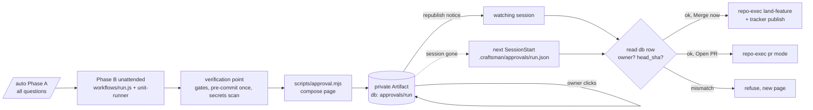
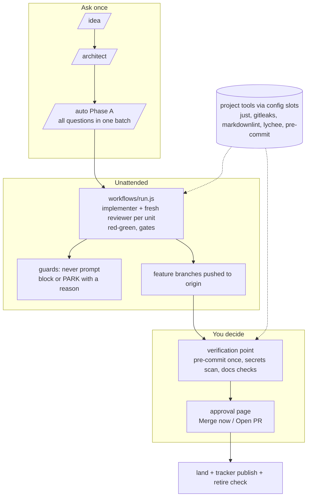

> **Human reference.** The loop never reads this file. What it enforces lives in
> [`approval.rules.md`](./approval.rules.md); if the two disagree, the rules file wins
> and `/architect --update approval` should be run.

# Approval architecture
_Last verified: 2026-10-23 at `b0328f6` · Source idea: [dev-lifecycle-docs-plan](../ideas/dev-lifecycle-docs-plan.md)_

## In plain English
A run asks every question up front, then works unattended until everything is built, reviewed and green on its feature branch. It then stops at one **verification point**. It publishes a private page that explains every change, flags anything you must think about (env keys, migrations, new dependencies, CI changes), shows the evidence, and says how to roll back.

The page has two buttons: **Merge now** and **Open PR**. The tool marks one as recommended. Your click is stored in a database row only you can write. The page then republishes itself, which notifies the session that is watching it. That session re-reads the row, checks it was you and that the code has not changed since the page was made, and only then lands. If the session has already ended, the next session in that repo picks up the approved run.

## How it fits

## Decisions
| id | decision | why | rejected alternatives |
|---|---|---|---|
| ARCH-APPROVAL-01 | Phase B stops at a verification point; nothing reaches base first | You want to see every change before base moves; feature-branch pushes still back work up | Run to merge unattended (no review point); checkpoint every phase (too many stops) |
| ARCH-APPROVAL-02 | Fixed page content: changes, attention list, evidence, risk and rollback | You asked for all four; a fixed shape makes pages comparable and testable | Free-form summary (misses .env changes) |
| ARCH-APPROVAL-03 | Private Artifact, two buttons, recommended choice, owner-only db row, republish as signal | Two buttons was your choice; db rules make the click authoritative; republish notifies a watching session without polling | Single Approve with automatic PR/merge choice; comments as the signal (anyone with comment access) |
| ARCH-APPROVAL-04 | Session verifies the row itself (owner + head_sha) | A notice or page text could be forged or stale; head_sha stops approving code that changed afterwards | Trusting the republish notice |
| ARCH-APPROVAL-05 | Pending runs survive the session; next session lands | You chose "next session picks it up"; no expiry | Keep the session alive; expire approvals |
| ARCH-APPROVAL-06 | Three events, time-to-approve in stats | Shows where runs wait on you | No telemetry |
| ARCH-APPROVAL-07 | Markdown + AskUserQuestion fallback | -p and offline runs must still land the same way | Fail the run |

## Data & flows
- `.craftsman/approvals/<run>.json` (local, gitignored) owns the request: artifact URL, plan, feature heads, recommendation.
- The Artifact's db doc `approvals/<run>` owns the decision `{choice, head_sha}`; only the owner can write it.
- Landing re-checks base (ARCH-LAND-27). A base move with green gates still lands; a conflict or a red gate produces a fresh page.

## Trade-offs & known limits
- The approval page is published to claude.ai (private). Summaries of code leave the machine; secret values never do. If a repo must not appear on claude.ai at all, use the ARCH-APPROVAL-07 fallback for it.
- Landing needs a live session. A click while no session runs waits until you open one in that repo.
- The PR-vs-merge recommendation is a heuristic; you can always click the other button.

## Slim Craftsman: the whole design on one page
Craftsman stays the engine but shrinks to what only it does: your lifecycle with enforcement (guards, ledger, worktree landing, ARCH rules), plus the approval page. Everything else is borrowed or delegated. Decided with the owner on 2026-10-22/23.

| goal | how the design meets it | rules |
|---|---|---|
| Token and usage efficiency | Measure baseline vs growth first; 3 KB bootstrap target; on-demand skills; ten model-visible entry points; reviewers capped by maxTurns; scrutinise docs and plan docs capped | SLIM-10, SLIM-12, DOCS-10, DOCS-11 |
| Simplicity | Ten entry points; no scaffolding; one approval page; profile kept in three existing places | SLIM-12, ENGINE-20, PLAN-07 |
| Effectiveness | Red-green units; fresh reviewer; verification before completion; partial-ledger guard; approval shows evidence and attention items | ENGINE-21, TRACKER-13, APPROVAL-02 |
| Performance | No mid-run prompts; narrower guard removes false blocks; pre-commit once, not per unit; base moved re-merges instead of re-asking | STATE-12, ENGINE-20, LAND-27 |
| Adaptability | Repo tools plug in through config slots; four global knobs with project overrides; stable channel for Gleam | ENGINE-20, PLAN-07, MOD-06 |
| Security | Secrets, outside-worktree deletes and publication are hard lines; force only with lease on own branches; approval verified by owner + head SHA | STATE-13, LAND-23, APPROVAL-04 |

### Superpowers comparison
| | Superpowers 7.0.1 | Slim Craftsman |
|---|---|---|
| Always loaded | ~3.2 KB bootstrap at SessionStart | target 3 KB (measured, ARCH-SLIM-10) |
| Workflow | brainstorm → plan → subagent per task → review → finish | idea → architect → plan → unit-runner + reviewer → approval → land |
| Enforcement | instructions only; no PreToolUse or Stop guards | hooks enforce scope, secrets, force, ledger, budgets |
| Status | none (plans only) | event-sourced ledger, generated views |
| Human checkpoint | finishing-a-development-branch asks merge/PR/keep/discard | one approval page with evidence, then Merge now / Open PR |
| Versioning | pinned `version` | commit-tracked, `stable` branch for Gleam |
| Taken from it | — | tiny bootstrap, TDD, systematic debugging, verification-before-completion |

Not co-installed: its auto-triggering skills would dispatch agents root-only mode blocks and create worktrees outside repo-exec, and Loost-Gallery already carries 62 orphaned Superpowers plans from the last mix.

### Order of work
1. Partial-ledger guard and `init --from-block` on main (ARCH-TRACKER-13/14); repair Loost.
2. Rebase and land PR #1.
3. Guard narrowing and weekly review (ARCH-STATE-12), force-with-lease (ARCH-LAND-23).
4. Approval page and landing gate (ARCH-APPROVAL-*, ARCH-LAND-22/24/27).
5. Measurement and safe cuts (ARCH-SLIM-10/12), tool slots (ARCH-ENGINE-20), TDD step (ARCH-ENGINE-21).
6. Budgets, rolling scrutinise, retire-candidate log (ARCH-DOCS-10/11, ARCH-LAND-26).
7. Vendored skills and profile knobs (ARCH-SLIM-11, ARCH-PLAN-07); `stable` branch for Gleam (ARCH-MOD-06).

Outside the plugin (owner's workstation): hourly btrfs snapshots and restic before step 2; a secrets scan of Loost's transcripts before deciding their future.

## Glossary
- **Verification point:** the moment all work is on feature branches and green, before base changes.
- **Run:** one /auto Phase B pass over a plan or feature set.
- **head_sha:** the feature branch commit the page describes.
