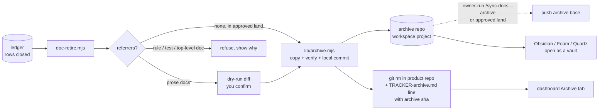

> **Human reference.** The loop never reads this file. What it enforces lives in
> [`archive.rules.md`](./archive.rules.md); if the two disagree, the rules file wins
> and `/architect --update archive` should be run.

# Archive architecture
_Last verified: 2026-10-23 at `7dc6c59` · Source idea: [external-project-board](../ideas/external-project-board.md)_

## In plain English
Finished plans stop living in the product repo. When a plan's work is all closed, Craftsman copies it (and its review docs) into one dedicated **archive repository** that sits in your workspace next to your projects, checks the copy is identical, and only then removes the plan from the product repo. What is left behind is one line in `TRACKER-archive.md` saying what the plan was for and where its archived copy is. The product repo shows only live work. The archive keeps every project's finished docs in one place you can browse, search and tidy.

Most plans are mentioned by other docs, which today blocks removing them. When the mention is in a plan, idea or review doc, the archive step rewrites it to a pointer to the archived copy, after showing you the exact lines and asking. A rule, a test or a top-level doc that cites the plan still stops it, because those are enforced files.

If a plan has no mentions at all, it is archived automatically when its feature lands. Anything else waits for you to run `/sync-docs --archive`. The archive repo is published only when you run that command or inside a landing you approved.

## How it fits

## Decisions
| id | decision | why | rejected alternatives |
|---|---|---|---|
| ARCH-ARCHIVE-01 | The archive is a registered workspace project; without one, retirement works as today | The manifest already validates Git roots inside the workspace and lands only registered projects (ARCH-LAND-07); a single-repo user loses nothing | A path in config outside the manifest (bypasses the registered-project rule) |
| ARCH-ARCHIVE-02 | `<product-id>/<kind>/<slug>/…` layout, never edited after commit | One tree for every project, so one vault shows all history | One archive repo per project |
| ARCH-ARCHIVE-03 | Copy, verify, commit in the archive repo before removing anything | Makes removal lossless; a failure aborts with nothing removed | Remove first, archive after (a crash loses the doc) |
| ARCH-ARCHIVE-04 | `archive <sha>` on the index line; `lookup` prints the restore command | A retired plan stays reachable from the one line left behind | A separate index file (ARCH-TRACKER-09 already rejected) |
| ARCH-ARCHIVE-05 | Push only owner-run or inside an approved land | Same limit as the tracker publish push; unit runners hold no credentials | Push on every retirement |
| ARCH-ARCHIVE-06 | Plans and closed siblings, rejected or deferred ideas; never architecture rules | Rules are superseded through `/architect` (ARCH-DOCS-05) | Archiving rules docs |
| ARCH-ARCHIVE-07 | Archive decluttering is owner-run, in confirmed rounds of 15 | The same safety the live repo has | Automatic expiry |
| ARCH-DOCS-13 | Prose referrers rewritten to archive pointers after a confirmed dry run; rules, tests and top-level docs still refuse | Your choice; without it most plans can never be archived (the dry runs refused 22 of 23 in Gleam and 12 of 15 here) | Tombstone stubs; keep refusing |
| ARCH-DOCS-14 | Automatic archive at landing only for a plan with no referrer and a verified copy; everything else owner-run | Your choice; the verified copy makes the move lossless, which is why the old "never automatic" rule can be relaxed for this case only | Always owner-run; fully automatic including the push |

## Data & flows
- **Owned by the archive repo:** the archived docs, one commit per archived plan.
- **Owned by the product repo:** the one index line per archived plan in `docs/plans/TRACKER-archive.md`, now with the archive commit's sha.
- **Local only:** `archive_push_pending` events until the next owner-run `--archive` or approved landing pushes.
- **Restoring:** `tracker.mjs lookup <slug>` prints `git -C <archive> show <sha>:<path>`.

## Trade-offs & known limits
- Needs a workspace manifest and a checked-out archive repo. Without them nothing changes.
- Rewritten links point at `archive:` pointers, which are readable text rather than clickable links until a viewer resolves them; the notes export (views) renders them as links to the archive note.
- The first sweep over a repo like Gleam will show many candidates the dashboard marks as blocked by rules, tests or top-level docs; those need an `/architect` pass, not a force.
- Two repos moving at once (product and archive) means a crash between them can leave an archive commit with the plan still in place. The re-run is idempotent and harmless.
- This design depends on the unmerged sibling branch for the approval and landing rules (`ARCH-LAND-22/24`), which are not yet on main. Until they land, "inside a landing the owner approved" means the existing `/craftsman:merge` and `/auto` approval.

## Glossary
- **Archive repo:** the dedicated Git repository holding finished docs for every project in the workspace.
- **Pointer:** `archive:<product-id>/<kind>/<slug>@<sha>`, what a mention becomes after archiving.
- **Candidate:** a closed plan not yet archived, with the reason it is waiting.

Owner decision (external-project-board, D2): ARCH-ARCHIVE-05 -> 09 (the archive push is owner-run only; a scripted push that PARKs a rejection is a future amendment) and ARCH-ARCHIVE-07 -> 10 (its check now names the prune-command tests in `views-wiring.test.mjs`). Rejected: building the scripted push now.
