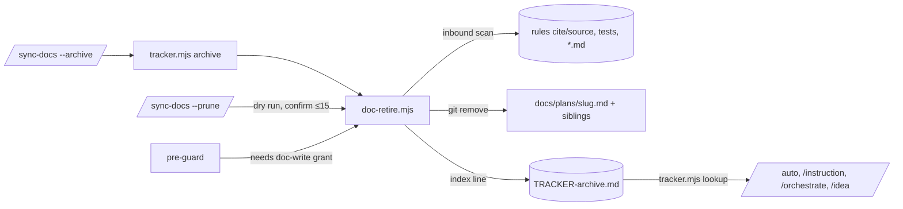

> **Human reference.** The loop never reads this file. What it enforces lives in
> [`docs.rules.md`](./docs.rules.md); if the two disagree, the rules file wins
> and `/architect --update docs` should be run.

# Docs lifecycle architecture
_Last verified: 2026-10-18 at `ac57d0e` · Source idea: [feature-branch-plans](../ideas/feature-branch-plans.md)_

## In plain English
Every plan creates a doc, and today nothing ever removes one. Retirement fixes
that. When every row of a plan is COMPLETE, `doc-retire.mjs` deletes the plan
doc and its `scrutinise-`/`investigate-` siblings. It leaves one line in
`TRACKER-archive.md` holding the doc's last commit sha, and git history is the
archive. `/sync-docs --prune` deletes stale docs in small, confirmed rounds. A
doc that anything still cites is never deleted.

## How it fits

## Decisions
| id | decision | why | rejected alternatives |
|---|---|---|---|
| ARCH-DOCS-01 | Retire in a new `doc-retire.mjs`, after `archive` | Keeps the ledger module free of git and testable on its own | Grow `tracker.mjs archive`; prose-only `git rm` in sync-docs |
| ARCH-DOCS-02 | Refuse when cited; list the referrers | A deleted doc must never leave a dangling cite | Delete and print the dangling list |
| ARCH-DOCS-03 | Lint checks `source:` | Deleting an idea must fail loudly | Silent breakage |
| ARCH-DOCS-04 | `--archive` / `--prune`, bounded and confirmed | Distinct verbs; deletion is never pre-approved | `--clean` / `--clear` (one letter apart) |
| ARCH-DOCS-05 | Supersede architecture; prune uncited rejected ideas to an index line | ADR practice; duplicate detection survives in one line | Never prune ideas; delete architecture |
| ARCH-DOCS-06 | Resolve slugs through `lookup` | A retired slug must not be re-planned | Check only that the file exists |
| ARCH-DOCS-07 | Doc-write grant for deletions, in the script and in pre-guard | `git rm` from Bash bypassed the grant | Script check only |
| ARCH-DOCS-08 | Events only, no new stats | Slimness | A stats section |

## Trade-offs & known limits
Retired docs are reachable only with `git show <sha>:<path>`; there is no UI for
them. A README cite pins a plan doc until someone removes the cite.

## Glossary
- **Retire:** remove a COMPLETE plan's doc and keep its index line.
- **Prune:** delete a stale doc after a confirmed dry run.

## Plan-hierarchy amendments (2026-10-18)
ARCH-DOCS-01 is superseded by ARCH-DOCS-09 (rollups removed with the plan; parents with live children refused). See [plan](./plan.md).

## Budget amendments (2026-10-23)
ARCH-DOCS-10: per-project doc budgets in `arch-check lint`, enforced by default. Caps start at today's sizes and only go down; a new plan gets 60 KB and a new scrutinise doc 30 KB. ARCH-DOCS-11: a scrutinise doc keeps one rolling summary and the latest round, with history in git (Gleam has one at 575 KB). ARCH-DOCS-02 was unchanged by this change (it is superseded below). A dry run found 22 of 23 finished Gleam plans and 12 of 15 here are cited elsewhere, so auto-delete was rejected. ARCH-LAND-26 logs candidates instead. See [approval](./approval.md).

## Archive amendments (2026-10-23)
ARCH-DOCS-12 is superseded by ARCH-DOCS-13: prose mentions of an archived plan are rewritten to archive pointers after a confirmed dry run, `docs/plans/NEXT.md` is never a referrer, and rules, tests and top-level docs still refuse. ARCH-DOCS-04 is superseded by ARCH-DOCS-14: a plan with no referrer and a verified archive copy is archived automatically at landing; prune and every other archive stay owner-run. See [archive](./archive.md).
