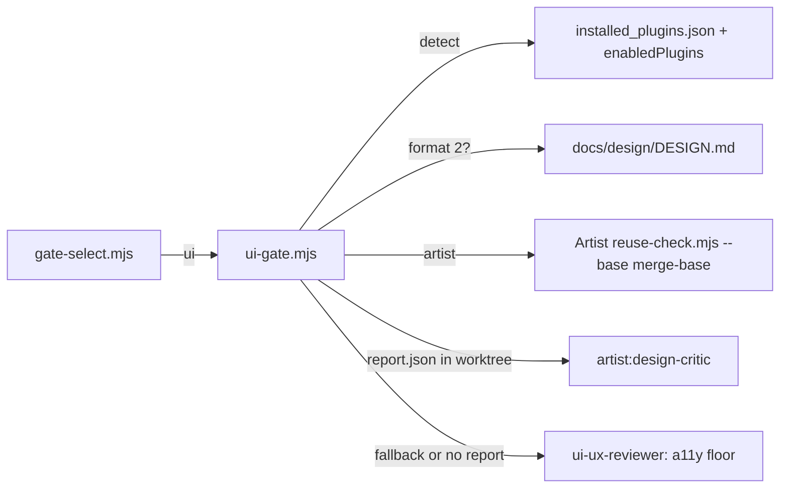

> **Human reference.** The loop never reads this file. What it enforces lives in
> [`gates.rules.md`](./gates.rules.md); if the two disagree, the rules file wins
> and `/architect --update gates` should be run.

# Gates architecture
_Last verified: 2026-10-26 at `5ddf5f0` · Source idea: [artist-ui-gate](../ideas/artist-ui-gate.md)_

## In plain English
After a unit is implemented, `gate-select.mjs` reads its diff and names the
advisory specialist gates that apply. When it names `ui`, `ui-gate.mjs`
decides how the UI review runs. If the separate Artist plugin is installed,
enabled and set up for the project (a format-2 `DESIGN.md`), Artist's
deterministic reuse-check runs on the diff. Artist's design critic also runs,
but only if the unit produced a verify report with screenshots. Otherwise,
and whenever no verify report gives axe results, craftsman's reduced
`ui-ux-reviewer` checks accessibility basics on the diff. Nothing in this gate
ever blocks a merge.

## How it fits

## Decisions
| id | decision | why | rejected alternatives |
|---|---|---|---|
| ARCH-GATES-01 | Routing in one script that prints JSON | Deterministic, testable with fixtures; keeps prose out of always-read docs (SLIM-03/05) | Routing prose in `_shared-execution.md` |
| ARCH-GATES-02 | Exact `artist@artist-marketplace`, installed and enabled, plus format-2 DESIGN.md | Never runs a disabled or same-named foreign plugin's script; reuse-check throws without DESIGN.md | Installed-only, any marketplace |
| ARCH-GATES-03 | Superseded by ARCH-GATES-07 | Its fixed argv left out Artist's justifications | — |
| ARCH-GATES-04 | Critic only with a verify report | The critic scores screenshots, not diffs; a unit gate has no dev server | Critic on every ui diff; gate starts a dev server |
| ARCH-GATES-05 | Reduced ui-ux-reviewer as accessibility floor | Projects without Artist keep a UI floor; axe only runs inside Artist's verify | Skip with a note; full old checklist |
| ARCH-GATES-06 | builtinAgents is user config | Guard code stays generic | Hardcode the critic in the guard |
| ARCH-GATES-07 | reuse-check with `--base <merge-base>`, run dir outside the worktree, plus the report's `justifications.json` when it holds a JSON object | reuse-check defaults to HEAD; a run dir inside the worktree could be committed by the unit; the fresh run dir hid the user's recorded justifications, and a bad file must not cost the critic | Fixed argv without justifications; pass a bad file and fall back |

## Trade-offs & known limits
Craftsman now follows Artist's CLI contract (arguments, exit codes, DESIGN.md
format 2). A breaking Artist change sends the gate to the fallback rather
than failing it. Hierarchy and "AI-slop" taste review now only happen through
Artist's critic, so a project without Artist loses them.

## Glossary
- **Verify report:** `.artist/runs/<ts>/report.json` from Artist's `verify.mjs` (screenshots, axe, Core Web Vitals).
- **Format 2:** the DESIGN.md layout Artist's `design-system init` writes.
