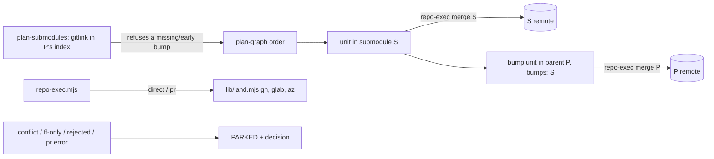

> **Human reference.** The loop never reads this file. What it enforces lives in
> [`landing.rules.md`](./landing.rules.md); if the two disagree, the rules file wins
> and `/architect --update landing` should be run.

# Landing architecture
_Last verified: 2026-10-18 at `ac57d0e` · Source idea: [autonomous-e2e-loop](../ideas/autonomous-e2e-loop.md)_

## In plain English
Running `/auto` gives it full authority to commit, branch, merge, push, land
and clean up. That covers the main repo and every project registered in
`craftsman.workspace.json`, including submodules registered there. Each repo
lands its own way (a direct merge, or an auto-merging PR) in plan order. When
a submodule changes, the parent repo gets its own follow-up unit that bumps
and commits the pointer. That unit says so with `bumps: "<submodule>"`, and
`plan-graph.mjs` refuses a plan that has submodule steps but no such unit, or
whose bump unit could land before them. A project counts as a submodule when
its parent's git index holds a gitlink at its path.

It never uses force operations. It stops only for real problems, by parking
the unit for the after-run question round: a merge conflict, a failed
fast-forward, a rejected push, or a PR that won't auto-merge.

## How it fits

## Decisions
| id | decision | why | rejected alternatives |
|---|---|---|---|
| ARCH-LAND-01 | `/auto` has standing git authority | User decision | Approve each merge in Phase C |
| ARCH-LAND-02 | *Superseded by LAND-08.* Each repo lands its own way, in plan order | Reuses `repo-exec` unchanged | — |
| ARCH-LAND-03 | An explicit pointer-bump unit, enforced by `plan-graph.mjs` | Reviewable, tracked, keeps repo-exec single-repo | An implicit bump in repo-exec (a hidden cross-repo write); protocol text alone |
| ARCH-LAND-04 | Superseded by ARCH-LAND-07 | Named `git submodule status`; the code reads the same gitlinks with `ls-files -s` | — |
| ARCH-LAND-07 | Registered projects only; submodules from index gitlinks, workspace root read only to refuse | Craftsman's explicit-workspace rule; `ls-files -s` reads the index gitlinks `submodule status` reports | Scanning for repos; `git submodule status` (needs `.gitmodules`) |
| ARCH-LAND-05 | No force operations | The user's CLAUDE.md and safety | — |
| ARCH-LAND-06 | Only listed failures park | User: stop only on real problems | — |
| ARCH-LAND-08 | *Supersedes LAND-02.* Units land on their declared target; features land via `land-feature` in a detached temp worktree | User decision: feature-branch merge model; the feature branch stays a ref, out of the sweep's reach | Hold the feature in its own worktree (sweep-exposed) |
| ARCH-LAND-09 | Push the feature branch at creation; `feature/` never inferred as base; sweep exempt | One code path for every `origin/<base>` use | Local-ref fallback |
| ARCH-LAND-10 | Spike before enabling | Final-merge conflict rate is the idea's kill criterion and is unmeasured | Ship directly |
| ARCH-LAND-11 | Submodule bump in the same feature as its submodule steps | A submodule commit on a feature branch isn't on base | Exclude submodules from features |
| ARCH-LAND-12 | PR mode: unit PRs → feature, one feature PR → base | One reviewable PR per feature | One PR per unit to base |

## Trade-offs & known limits
An unregistered nested repo is invisible to `/auto`; register it first. A
submodule held by an unregistered superproject at the workspace root is
refused until that root is registered. A superproject that is unregistered
and not the workspace root is not detected. The bump check runs when the plan
is checked, not again at landing. A `pr`-mode repo waits on its CI before
dependants can land.

## Plan-hierarchy additions (2026-10-18)
ARCH-LAND-13..17: one worktree per feature, `land-unit`, wave worktrees, the plan-lands-first gate and the publish push authority. See [plan](./plan.md) for the reasoning and rejected alternatives.

## Network phase (2026-10-22)
Unit runners run in Claude Code's sandbox, which denies the credential files git's helper reads (`~/.config/gh`) and must stay that way. **ARCH-LAND-19** therefore splits network from work: root fetches the base before a run and drains queued pushes after it (`repo-exec` action `network`, run outside the sandbox); runners only do local git, and `repo-exec` queues each push as a plain pinned-sha refspec instead of attempting it. Chosen over passing a short-lived token per call (a secret in a sandboxed process, and one more place to leak it) and over degrade-only (no way to ever push). A step that needs the host API (`pr` mode) or a fresh fetch exits 3 before any side effect with one message naming the fix; the workflow returns `needs_network` and root resumes. **ARCH-LAND-20** attaches a detached submodule checkout when that moves nothing. See `commands/_network.md`.

## Plan-hierarchy amendments (2026-10-18)
ARCH-LAND-08 is superseded by ARCH-LAND-18 (units land by `land-unit` inside the feature worktree). See [plan](./plan.md).

## Approval amendments (2026-10-23)
ARCH-LAND-01 → 22: /auto pushes its own branches freely, but base, PRs and external posts wait for the approval page; Phase A answers authorise the docs-only plan push. ARCH-LAND-05 → 23: `--force-with-lease` only, only on branches the run created. ARCH-LAND-17 → 24: tracker publish to base happens inside an approved land. ARCH-LAND-18 → 25: cite corrected to `repo-exec.mjs:568-670`. New: ARCH-LAND-26 (retire check logs candidates, never deletes) and ARCH-LAND-27 (moved base re-merges, re-gates, lands if green). See [approval](./approval.md) for the reasoning and rejected alternatives.
