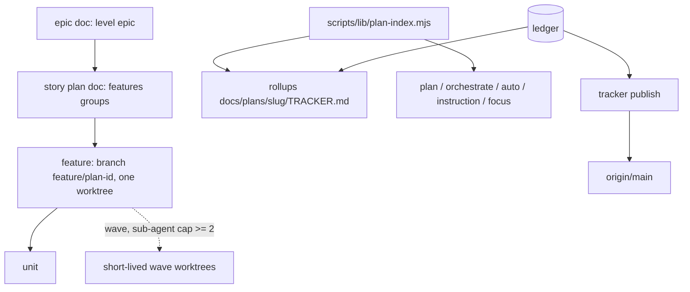

> **Human reference.** The loop never reads this file. What it enforces lives in
> [`plan.rules.md`](./plan.rules.md); if the two disagree, the rules file wins
> and `/architect --update plan` should be run.

# Plan architecture
_Last verified: 2026-10-18 at `a211674` · Source idea: [plan-hierarchy](../ideas/plan-hierarchy.md) (with [session-dispatcher](../ideas/session-dispatcher.md))_

## In plain English
Plans are organised in four levels. An **epic** is a thin document that lists
the larger changes ahead. A **story** is a plan document that groups
**features**. A **feature** is a group of units that one session owns, with its
own branch and exactly one long-lived worktree. A **unit** is today's unit.
Each epic and story gets a generated `TRACKER.md` rollup; the ledger stays the
only source of truth. `/orchestrate` and `/auto` target any level and default
to a feature. Existing plans need no rewrite: no `level:` means feature.

Progress reaches `main` through `tracker publish` (a locked, idempotent commit of
generated files only), so you can follow a run without opening a worktree.
Code reaches `main` once per feature (`land-feature`). A plan must be on
`main` before a feature worktree is created.

## How it fits

## Decisions
| id | decision | why | rejected alternatives |
|---|---|---|---|
| ARCH-PLAN-01 | Adopt the feature-branch design's "feature" (a group of units in a plan); a plan with no groups is one implicit feature | Inherits the sibling's decided rules instead of reversing about eleven | Plan doc = feature (reverses them); both shapes (two code paths) |
| ARCH-PLAN-02 | One `plan-index` parser | Replaces three ad-hoc frontmatter regexes; `plan-graph` stays pure | Grow plan-graph; parse inside tracker.mjs |
| ARCH-PLAN-03 | `--level`, default feature, sequential subtree | Matches "orchestrator follows features by default, with the option" | Default to the slug's own level |
| ARCH-PLAN-04 | No forced migration | 7 of 11 plans have hand-written rows outside the ledger | Re-register legacy rows (invents history) |
| ARCH-PLAN-05 | `priority` now, scheduler later | Session-dispatcher verdict: ship the read-only queue after the spikes | Build the dispatcher now |
| ARCH-PLAN-06 | Every slug consumer goes through plan-index | Makes /auto and /instruction use the structure fully | Per-command parsing |
| ARCH-TRACKER-10 | Generated rollups in `docs/plans/<slug>/TRACKER.md` | Owner wants a tracker file per level; folder keeps slug names clean | `<slug>.tracker.md` (basename becomes a bogus slug) |
| ARCH-TRACKER-11/12 | `publish` + `TRACKER.jsonl` snapshot, refuse-to-blank | Ledger is gitignored per machine; output is a pure function of it, so a retry never needs a merge | Commit the ledger; render into the landing commit; progress ref |
| ARCH-LAND-13..15 | One feature worktree; `land-unit`; wave worktrees | Park/block semantics and reviewer diffs survive; one session = one long-lived worktree | Commit straight on the feature branch; two writers in one tree |
| ARCH-LAND-16 | Plan gate in `repo-exec prepare` | Mechanical, no hook latency | Hook marker; prose only |
| ARCH-LAND-17 | `tracker.publish` default push | Matches "always push updates to main" | Off by default |
| ARCH-STATE-09 | Keep scope keyed by worktree; replace and release per unit | Re-keying by (worktree, unit) makes `readScope` ambiguous | Key by unit |
| ARCH-ENGINE-16/17 | Waves of 2+ units, spike-gated | Your ask: sub-agents run two units at once | Same-worktree parallelism; sequential only |
| ARCH-AUTO-09 | `/auto` stops when all descendant rows are COMPLETE | An epic slug has no rows and would hold the marker for 24 h | — |

## Data & flows
Ledger → (plan-index) → rollups → `publish` → `origin/<base>`. `publish`
renders into a detached temp worktree at `origin/<base>` under the base merge
lock, so the working tree of the main checkout is never touched.

## Trade-offs & known limits
- Dozens of `docs(tracker)` commits a day with several sessions; a no-op for `land: pr` repos.
- Doc budgets are full (orchestrate.md, plan.md, _shared-execution.md, unit-runner.md): new protocol text goes in a conditionally read reference doc.
- Legacy hand-written rows stay invisible to rollups.
- UNPROVEN: whether Claude Code's worktree isolation lets a `node` script push from a `.claude/worktrees/` session, and the value of `CLAUDE_PROJECT_DIR` inside one.

## Pending amendments (need the feature-branch-plans architecture on this branch)
That work (branch `worktree-idea-feature-branch-plans`, 64c86de) is not on this branch. Once it lands, `/architect --update` must:
1. Supersede its ENGINE-14 with a version that treats a plan without `features:` as one implicit feature on the feature-worktree path.
2. Supersede its LAND-08 with a version where a unit lands by `land-unit` inside the feature worktree (the `land-feature` half is unchanged).
3. Amend its DOCS-01 so retirement also removes `docs/plans/<slug>/TRACKER.md` and refuses a parent with live children.
4. Add `feature:` to the `publish` triggers (FEATURE_MERGED).

## Glossary
**Wave**: units of one feature running together. **Rollup**: the generated tracker of an epic or story. **Publish**: the locked commit of generated progress files to base.
