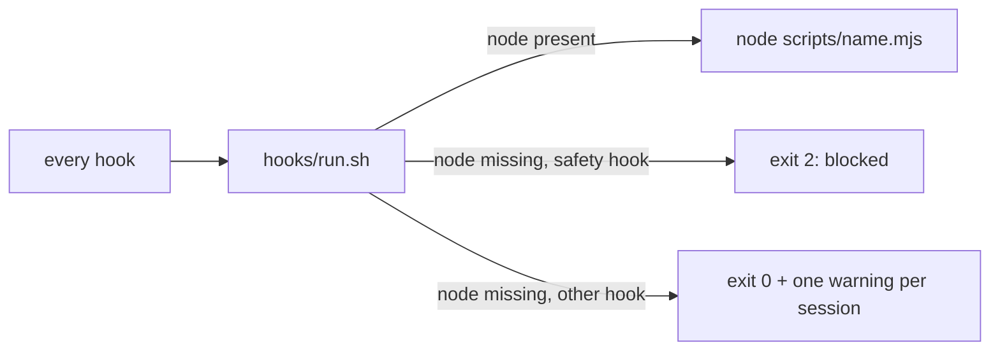

> **Human reference.** The loop never reads this file. What it enforces lives in
> [`safety.rules.md`](./safety.rules.md); if the two disagree, the rules file wins
> and `/architect --update safety` should be run.

# Safety architecture
_Last verified: 2026-10-21 at `44cd3ed` · Source plan: [fixes-and-safety](../plans/fixes-and-safety.md)_

## In plain English
Craftsman's guards are Claude Code hooks, so they only protect you while they
actually run. This area is about what happens when they cannot: a missing `node`,
bad input, a thrown error. The rule is that a guard that cannot run must say so
and, where it protects something, block the call instead of letting it through.

Craftsman does not try to be the sandbox. Writes and deletes outside the project,
and reads of credentials, belong to the Claude Code sandbox. Craftsman covers what
the sandbox cannot see: its own docs, scope, tracker and git rules.

## How it fits

## Decisions
| id | decision | why | rejected alternatives |
|---|---|---|---|
| ARCH-SAFETY-01 | The sandbox owns outside-root writes, deletes and credential reads | It enforces at the OS level; a shell-text guard can always be bypassed | Re-implementing path checks inside pre-guard |
| ARCH-SAFETY-02 | Safety hooks fail closed through `hooks/run.sh` | A missing node used to switch every guard off without a word | Letting the hook fail open and logging it |
| ARCH-SAFETY-03 | The guards also deny in process on bad input or an error | An uncaught error exits 1, which Claude Code treats as non-blocking, so the guard was silently off | Relying on `onFailure: block` alone (it needs 2.1.295+) |

## Trade-offs & known limits
- A machine without `node` now blocks every guarded tool call until node is installed. That is the point; the message names the cause.
- `run.sh` adds one `sh` process in front of every hook. Step 14 of the plan measures it.
- `onFailure: "block"` (Claude Code 2.1.295+) is recorded on the pre-guard and agent-mode-guard entries as a second layer; it has no effect on Stop hooks.
