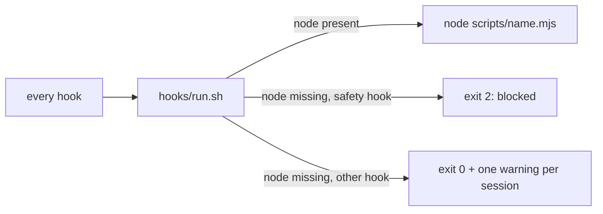
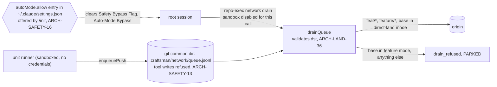

> **Human reference.** The loop never reads this file. What it enforces lives in
> [`safety.rules.md`](./safety.rules.md); if the two disagree, the rules file wins
> and `/architect --update safety` should be run.

# Safety architecture
_Last verified: 2026-11-03 at `a8515bc` · Source plan: [fixes-and-safety](../plans/fixes-and-safety.md)_

## In plain English
Craftsman's guards are Claude Code hooks, so they only protect you while they
actually run. This area is about what happens when they cannot: a missing `node`,
bad input, a thrown error. The rule is that a guard that cannot run must say so
and, where it protects something, block the call instead of letting it through.

Craftsman does not try to be the sandbox. Writes and deletes outside the project,
and reads of credentials, belong to the Claude Code sandbox. Craftsman covers what
the sandbox cannot see: its own docs, scope, tracker and git rules.

## How it fits

## Decisions
| id | decision | why | rejected alternatives |
|---|---|---|---|
| ARCH-SAFETY-01 | The sandbox owns outside-root writes, deletes and credential reads | It enforces at the OS level; a shell-text guard can always be bypassed | Re-implementing path checks inside pre-guard |
| ARCH-SAFETY-02 | Safety hooks fail closed through `hooks/run.sh` | A missing node used to switch every guard off without a word | Letting the hook fail open and logging it |
| ARCH-SAFETY-03 | The guards also deny in process on bad input or an error | An uncaught error exits 1, which Claude Code treats as non-blocking, so the guard was silently off | Relying on `onFailure: block` alone (it needs 2.1.295+) |
| ARCH-SAFETY-04 | Advisory hooks fail open but never silently, and SessionStart states the guard state | A guard that is off for a reason nobody saw is worse than one that is plainly off | Failing every advisory hook closed (it would block work over a formatter) |
| ARCH-SAFETY-05 | Only `CRAFTSMAN_SAFETY=off` in the user's environment turns safety off; a tool call is refused, by token matching, when it would touch the off flag, the grant, marker, goal-token and scope files (also by `mkdir`, `ln` or a symlink), the safety config keys (including `repoExec.approval.required` and `planning.featureBranches`, which switch the human approval gate on), `hooks.json` or the hook-disabling keys of `.claude/settings*.json` | `CRAFTSMAN=off`, `.craftsman/off` and `enabled:false` were all one tool call away for the model | One shared off switch for everything |
| ARCH-SAFETY-06 | Stop and SessionEnd report unpushed work in every worktree, from local refs only; Stop blocks only when `stopGate.blockOnUnpushed` is true | Work that exists on one machine only is lost with the machine; blocking by default would stall every scratch session | Fetching to compare (slow, needs network and credentials) |
| ARCH-SAFETY-07 | The worktree sweep is evidence-based and reversible: merged means merged into a remote-tracking ref, local data and Claude Code's own worktrees are kept, every branch deletion is logged with its sha | A sweep that trusts a local main, or deletes a `.env`, loses work with no way back | Deleting any merged-looking worktree and relying on reflog |
| ARCH-SAFETY-08 | Safety does not depend on git anchoring: outside a repo the protected-path, scope, dispatch and fail-closed checks stay on and only the quality, doc and tracker machinery goes off, writing no state | A session opened in a home directory is exactly where nothing else is watching | Leaving everything off outside a repo, as before |
| ARCH-SAFETY-09 | The mod submits a goal only if craftsman wrote it this session, proven by a per-session token (name and mtime) that `goal-token.mjs` records after /instruction or /auto (for a file in the worktree's or the main checkout's `.craftsman/instructions`; from a linked worktree the mod may still fall back to the paste path, which fails closed) and no tool call can write | The mod submits as the user, so a goal file written by anything else would be a prompt-injection amplifier | Trusting every file under `.craftsman/instructions` |
| ARCH-SAFETY-10 | Post-hoc detection reports and never replaces the guard: SessionStart snapshots guarded docs, Stop reports changes the doc guard did not allow, `/craftsman:init` only offers the sandbox settings merge | A report cannot stop a bad edit, so it sits beside the guard, not instead of it | Blocking at Stop on any doc diff (it would fire on every legitimate /plan) |
| ARCH-SAFETY-11 | A filter in front of pre-guard may skip it only where it cannot act: the launcher skips node for Read, Glob and Grep with no scope state, nothing protected-looking in the call and no project `protectedPaths` override | Starting node costs ~25 ms on every read in a session that has no unit scope; but pre-guard also blocks reads of `.env`, `node_modules` and lock files with no scope, so a bare "no scope, skip" would have opened them | Hook `if` (cannot test for scope files), skipping all reads when no scope exists |
| ARCH-SAFETY-12 | The sandbox settings `/craftsman:init` offers ask only for what the sandbox cannot protect inside the project (sudo, force push, hard reset, git clean), not for `rm -r`/`rm -rf`; existing asks in the user's file are never removed | With the sandbox on, an `rm -rf` ask overrides auto mode and interrupts unattended runs for deletes the sandbox already confines (owner decision 2026-10-27) | Keeping every ask (prompts in sandboxed auto runs); dropping all asks (git reset --hard and git clean destroy uncommitted work the sandbox does not protect) |

## Trade-offs & known limits
- A machine without `node` blocks every guarded tool call until node is installed. That is the point; the message names the cause.
- `run.sh` adds one `sh` process in front of every hook; the Read/Glob/Grep filter more than pays for it (measured: the skipped path adds under 1 ms p95 over 200 runs; starting node costs about 25 ms).
- `onFailure: "block"` (Claude Code 2.1.295+) is recorded on the pre-guard and agent-mode-guard entries as a second layer; it has no effect on Stop hooks.
- The self-protection and hook-bypass checks match tokens, with no new shell parser. Anything they cannot read stays with the sandbox (ARCH-SAFETY-01): files written by an interpreter (`node -e`, `python3 -c`, a pipe into `sponge`), command text built at run time, `make`, and a script written earlier in the same command. Also unread: what an archive or a patch contains when it is unpacked into, or applied to, a directory that is not itself protected (`tar -xf x.tar` in the project root, `patch -p1 < x.patch` with no named file), a source tree larger than 2000 entries (treated as holding anything protected under its destination, so such a copy into a protected directory is refused), and writers not listed here (`zip -g`, `git apply`, `git checkout <ref> -- <path>`). Also unread, by decision after six reviews of the same class: a variable set by `for NAME in …` or `select NAME in …` or a brace-built name (`export CLAUDE_CODE_SESSION_{ID,X}=…`; the session-id forms gain nothing because the nonce belongs to the real session, and a fake `HOME` needs a model already acting against the session), and awk in-place named by an include path (`gawk -i /usr/share/awk/inplace.awk`; the guard reads `-i inplace`). The opposite error is kept too: prose such as `echo 'hooks read CLAUDE_PROJECT_DIR first'` is refused, because the setter check matches words, not command position. Options taken from the environment are also invisible to the guard, which judges the destination as the current directory: `UNZIP=-d.craftsman unzip -o a.zip`, `UNZIPOPT=-d.craftsman unzip -o a.zip` and `TAR_OPTIONS=-C.craftsman tar -xf a.tar` write protected state and are allowed. Refusing an `UNZIP`, `UNZIPOPT` or `TAR_OPTIONS` assignment before an extraction would close it; that is left as the user's choice. Each is pinned by `safety-claims.test.mjs` or stated here; the sandbox owns them (ARCH-SAFETY-01).
- Authority scripts (`doc-write.mjs on`, `toggle.mjs off`, `goal-token.mjs`) need two things: the owning command's record for the session, and a one-shot nonce that pre-guard leaves for the session of the tool call when it lets a plain `node …/<script>` command through (60 seconds, consumed on use, so another session's record or a spawned child cannot use it). The nonce is never skipped, by the script's own environment or by a file, because anything a child process or another session can set or lend is a way round. With `CRAFTSMAN_SAFETY=off` no guard runs, so `doc-write.mjs on` is a no-op there (it prints that no grant is needed and writes nothing, so a spoofed value gains nothing); `toggle.mjs off` and `goal-token.mjs` keep refusing, so use a session with safety on for `/instruction`, or edit `.craftsman/off` yourself.
- Archive extraction (`tar -x`, `unzip`) is read exactly only in an allowlist of spellings (argument-free option clusters, `-C`/`--directory`/`-d`, chained `-C`s judged in order). Anything else (`tar -xvC DIR -f a.tar`, `tar xfC a.tar DIR`, `--dir=DIR`, `unzip -od DIR`) leaves the destination unknown, and the command is refused outright, whatever it names (a word-by-word judgement lost a `-C` chain and ignored values attached inside a cluster, and was removed). A refusal of a legitimate unusual `tar` or `unzip` is the price; spell it `-C DIR` / `-d DIR`, or ask the user to run it. There is no list-only skip for `unzip`: it was tried with letter lists, a leading-words rule, a plain-cluster rule and a value-taking-letter exclusion, and each version had a hole (`-P`/`-O`/`-I` take the rest of their cluster as a value, `--l` negates `-l`, a `-l` after the zipfile is a member pattern while the command still extracts into the current directory, which `cd` can make protected). `unzip -l a.zip`, `-v`, `-c`, `-z`, `-hh` and `unzip -l -d DIR a.zip` are therefore refused like any spelling off the allowlist; run them outside the model. Archive and option spellings are best-effort; the sandbox is the boundary for them. A linked worktree session keeps its scope manifests, command records and grants in the main checkout's `.craftsman` (shared through the git common dir), so the guard judges those paths there as well as under its own root, and the launcher always runs the guard for a project that is a linked worktree; before the merge with main, the protection looked only under the worktree's own `.craftsman`. The quality gates are not a security boundary either: the tracker's MERGED acceptance gate, `baseline` and `snapshot` honour `CRAFTSMAN=off` in a script's own environment (it is your documented switch for the quality side), so a command can set it for one script; `tracker.test.mjs` pins this. No authority check (the grant, the nonce, the goal token, the toggle) reads that variable. Harmless examples that are refused today because the option is off the list: `tar --exclude=…`, `--zstd`, `--strip-components N`, `--one-top-level`, `--to-stdout`, `--` and `unzip -x PATTERN`; drop the option or ask the user to run it. The message names the word it could not read. `doc-retire.mjs` (`/sync-docs --archive`), the one other reader of the doc-write grant, always requires it: it once skipped the grant when `CRAFTSMAN_SAFETY` was off in its own environment, and a loop that exported the variable made it delete a plan with safety on, so nothing is skipped or granted on the strength of that variable and `--archive` needs a session with safety on. The nonce is left only once every later check has passed; a permission prompt that follows it is not covered, and it expires after 60 seconds. A model Skill call of a doc-writing command (`/orchestrate` under `/auto`) counts as that command's record by decision; only `toggle off` needs the user's typed command.
- A writer verb anywhere in a command plus a protected file name anywhere in it is refused, even when the name is only read (`mkdir -p build && jq . craftsman.config.json`). This false positive is kept on purpose: narrowing it to the writer's own operands would open a new bypass, and the guard prefers refusing to loosening.
- Settings protection is narrower than "the file": any change to `disableAllHooks` or `hooks`, to craftsman's own `enabledPlugins` entry, or to a `CRAFTSMAN*` env key is refused; other keys (`permissions`, `theme`, other plugins, other env) stay editable. A Bash write to either settings file is refused whole. A symlink is followed for Write, Edit and redirects (by real path) and a `ln` that mentions `.craftsman` is refused; a link made some other way to a path the command never names is not seen.
- A hook-skip spelling is read at token level through `env`/`sudo`-style wrappers (with their value-taking options), `sh -c` bodies up to three deep, `git config` of the hooks path or of a skipping alias (`git config set` too, and `-c alias.X=` like it), the skip flag of `merge`, `rebase`, `am` and `cherry-pick` as well as `commit` and `push` (`-n` means no-verify only for `commit`), `GIT_CONFIG_*` env, and the routes that reach the hooks path through another file: `include.path` and `includeIf.*.path` (as `-c`, `git config` or `GIT_CONFIG_KEY_n`), and `GIT_CONFIG`, `GIT_CONFIG_GLOBAL`, `GIT_CONFIG_SYSTEM`, `HOME` or `XDG_CONFIG_HOME` pointing at anything but `/dev/null` (set as a prefix, through `env`, or earlier in the command by `export` or a plain assignment) while the command runs a hook-running subcommand; a `GIT_CONFIG_KEY_n` is read with its quotes removed. A `HOME=<dir>` prefix is therefore refused for `git commit`, `push`, `merge`, `rebase` and `am` even when it is only meant to isolate a test: use `/dev/null`, or set the identity another way. A body built at run time (`eval`, a variable), and a config file written somewhere the guard does not look (outside the project, ARCH-SAFETY-01) are not read: they stay with the sandbox.
- `pre-guard` checks protected paths against `tool_input.file_path` only, so a Grep or Glob named by `path` (for example `path: .env`) is not path-checked. This predates the safety work; the launcher filter keeps the same verdict and the parity table pins it.
- With no remote ref the sweep removes nothing, so a repo-exec session whose merged worktree survives gets "WORKTREE NOT SWEPT" at Stop until it is removed by hand.
- `CRAFTSMAN=off` no longer lifts the agent-mode guard; set `execution.agentMode: "subagents"` to dispatch for real.

## SessionEnd display (checked 2026-10-21, Claude Code 2.1.306)
`scripts/session-end.mjs` writes the unpushed-work report and the hand-off to **stderr**, the channel the hooks reference
documents for the user at exit. `claude plugin test` only runs mod tests, so it cannot show hook output; instead a headless
`claude -p` run with a project `SessionEnd` hook that wrote to stderr and printed `{"systemMessage": ...}` to stdout showed:
the hook fires (`SessionEnd:other`, exit 0) and the JSON is parsed, but **neither channel appears in `stream-json` output**
(there is no UI in `-p`). Whether an interactive session shows `systemMessage` at exit is therefore **unconfirmed**; the report
uses stderr only, and Stop (which does show `systemMessage`) carries the same report every turn.

## Phase 2 amendments (2026-11-01, owner-approved)
_Verified at `a0cb8a2`. Source: the "Open decision — phase 2" section of [sandbox-auto-flow](../plans/sandbox-auto-flow.md); `/idea` was skipped, and every claim there was checked against the code and the 2026-11-01 transcript sweep._

**Status: implemented (2026-11-03; plans [sandbox-auto-flow-phase-2](../plans/sandbox-auto-flow-phase-2.md) and [its review rounds](../plans/scrutinise-sandbox-auto-flow-phase-2.md)).** The network push queue is protected state, a quoted heredoc that merely names a safety variable passes, command records last the session, `/init` offers the origin hosts and the user-scope `autoMode.allow` entry, and the drain validates every entry. Five isolated review rounds also hardened the surface around it; the gaps they left open are listed first under the limits below.

Unattended runs kept stopping for two reasons. First, the sandbox hides git credentials from root's network step. Second, the guards refuse harmless text. Root still runs fetch and drain outside the sandbox, but auto mode now has one explicit, user-approved entry for exactly that step. Drain refuses anything aimed at base, and its queue is protected the way approval records are. The text-scanning guards are now stated to be accident prevention. They narrow false positives where the text is provably inert, and they stop chasing unusual bypass spellings, because the boundary is the sandbox, not text matching.

| id | decision | why | rejected alternatives |
|---|---|---|---|
| ARCH-SAFETY-13 (replaces 05) | Same rule with three changes. The network push queue becomes protected state. A quoted-delimiter heredoc body fed to cat, tee, python3 or node no longer trips the setter rule. A command record now lasts the session, except `/craftsman:toggle`'s, which still expires after one hour. | A probe wrote `{"kind":"delete","dst":"main"}` into the queue with a Write and with `echo >>`, and drain would have run it with the user's credentials. Refusing heredoc prose gained nothing, because an interpreter's own environment changes were already outside what the guard reads. 211 of 237 "doc-write.mjs on outside /plan…" refusals came more than an hour into a run, and every doc writer except `/builtin-check` is model-invocable, so the hour bounded nothing. (The plan blamed chaining, and that was wrong: chained `doc-write.mjs on; …` passes on main and on the installed plugin.) | Drain validation alone: kept as ARCH-LAND-36, but a forged queue would still feed an unattended step. Keeping the heredoc false positive: the Write-tool workaround cost turns in every long run. |
| ARCH-SAFETY-16 (replaces 14) | /init's project block adds origin hosts to `allowedDomains` and no `excludedCommands`. A separate user-scope offer adds one `autoMode.allow` entry for the network step; it says the run's own branches, and base only in direct-land mode. | Gleam logged 62 `CONNECT tunnel failed, response 403` because github.com wasn't allowed, plus 13 auto-mode denials of the unsandboxed retry (`[Safety Bypass Flag]`, `[Auto-Mode Bypass]`). Both are soft-deny rules that an allow entry can clear, and auto mode reads `autoMode` only from user, managed or `--settings` scope. | A docker exclusion: the docker socket is root-equivalent, and craftsman would be the one proposing that loosening. A `permissions.allow` rule: the exact plugin path changes every upgrade, and a `*` in its place would match `../`. Masked credentials with TLS termination: every sandboxed command, runners included, could then push as the user, which ARCH-LAND-19 rules out. The entry first said "never base"; a direct-land unit merge pushes base (`repo-exec.mjs:411`), so that wording was wrong (owner decision 2026-11-02). |
| ARCH-SAFETY-15 | Superseded by ARCH-SAFETY-17. | Its sandbox-as-boundary premise was false for in-project protections. | — |
| ARCH-SAFETY-17 (replaces 15) | The text-scanning guards are accident prevention. The sandbox only bounds effects outside the project, so for the bound worktree and for `git clean` of guarded docs the guards are the only line. A bypass spelling a model would not write in ordinary work is a stated limit, and review reports it as a Suggestion. | Sandboxed commands may write the whole project and unit worktrees sit under the main checkout (`scripts/repo-exec.mjs:266`); 19 review rounds each reported new spellings as Warnings (owner decision 2026-11-03, docs/ideas/guard-redesign.md). | A git `reference-transaction` hook: misses `git clean` and index or working-tree changes, runs on the user's own git, and can be skipped by spelling. Moving worktrees outside the main checkout: a large repo-exec change, revisited only if the owner raises the strength. |

Trade-offs and known limits:
- The allow entry is prose that the classifier reads, so the classifier can still refuse a call. A refusal stops the run the way `needs_network` does (ARCH-LAND-35). `/craftsman:stats` "Sandbox bypasses" shows how often that happens.
- A fetch from a private repo needs credentials, so `allowedDomains` alone can't make a sandboxed fetch work: Gleam logged 99 `could not read Username for 'https://github.com'`. A public repo fetches fine.
- **Stated limits of the worktree git guard** (F1; live and accepted under ARCH-SAFETY-17): a nested or `function` cd, CDPATH, a GIT_DIR set by `for`, `read` or `printf -v`, `-c alias.*` or `core.worktree`, a glob-spelled git path, the wrappers `script -c`, `flock -c`, `su -c` and `watch`, git-as-runner options, and rebinding by `trap` or `alias`.
- **Stated limits of the doc-deletion guard** (owner, 2026-11-02, under ARCH-SAFETY-17; the guard of ARCH-DOCS-07 and ARCH-STATE-16): an alias in another repository's config reached through `git -C <dir>` or an earlier `cd`/`pushd`; the self-protection scan reading `$'…'`/`$"…"`-decoded names; positional parameters set other than by `set` (a function call); a nested array subscript in a default assignment (`${z[a[1]]=l}`); and the cost of the `${a[` subscript scan on very long text. Each was found by a scrutinise round and left to the sandbox.
- **Stated limits found in review round 5** (owner, 2026-11-03, under ARCH-SAFETY-15: five rounds of hardening the Bash text guard each found four or five fresh spellings, most older than the reviewed range, so these are recorded in ARCH-SAFETY-13 and left to the sandbox; their follow-up rows are cancelled): `find -delete` and `-exec rm` miss the queue, `.git/modules/**` and commondir/gitdir (`followup-find-delete-stale-consumer`); a glob in the last path segment onto a `**/`-anchored never-written file (`followup-last-segment-glob`); the gitfile refusal reads literal targets only (`followup-gitfile-spellings`); a link source built from `$PWD`, `$(pwd)` or `~+` (`followup-dynamic-link-source`); several `-t` options with a large source can push the guard past its 10 s hook timeout (`followup-multi-target-latency`). Round 6 added two more, recorded the same way: a gitfile replaced across two commands, and an option after the operands read as the destination.
- Still refused on purpose: `echo` prose that names a setter next to a safety variable, an unquoted `<<EOF` body, and any unreadable command that can write and names craftsman state.
