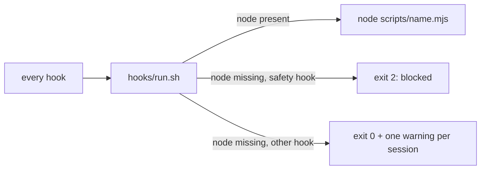

> **Human reference.** The loop never reads this file. What it enforces lives in
> [`safety.rules.md`](./safety.rules.md); if the two disagree, the rules file wins
> and `/architect --update safety` should be run.

# Safety architecture
_Last verified: 2026-10-21 at `96a029c` · Source plan: [fixes-and-safety](../plans/fixes-and-safety.md)_

## In plain English
Craftsman's guards are Claude Code hooks, so they only protect you while they
actually run. This area is about what happens when they cannot: a missing `node`,
bad input, a thrown error. The rule is that a guard that cannot run must say so
and, where it protects something, block the call instead of letting it through.

Craftsman does not try to be the sandbox. Writes and deletes outside the project,
and reads of credentials, belong to the Claude Code sandbox. Craftsman covers what
the sandbox cannot see: its own docs, scope, tracker and git rules.

## How it fits

## Decisions
| id | decision | why | rejected alternatives |
|---|---|---|---|
| ARCH-SAFETY-01 | The sandbox owns outside-root writes, deletes and credential reads | It enforces at the OS level; a shell-text guard can always be bypassed | Re-implementing path checks inside pre-guard |
| ARCH-SAFETY-02 | Safety hooks fail closed through `hooks/run.sh` | A missing node used to switch every guard off without a word | Letting the hook fail open and logging it |
| ARCH-SAFETY-03 | The guards also deny in process on bad input or an error | An uncaught error exits 1, which Claude Code treats as non-blocking, so the guard was silently off | Relying on `onFailure: block` alone (it needs 2.1.295+) |
| ARCH-SAFETY-04 | Advisory hooks fail open but never silently, and SessionStart states the guard state | A guard that is off for a reason nobody saw is worse than one that is plainly off | Failing every advisory hook closed (it would block work over a formatter) |
| ARCH-SAFETY-05 | Only `CRAFTSMAN_SAFETY=off` in the user's environment turns safety off; a tool call is refused, by token matching, when it would touch the off flag, the grant, marker, goal-token and scope files (also by `mkdir`, `ln` or a symlink), the safety config keys, `hooks.json` or the hook-disabling keys of `.claude/settings*.json` | `CRAFTSMAN=off`, `.craftsman/off` and `enabled:false` were all one tool call away for the model | One shared off switch for everything |
| ARCH-SAFETY-06 | Stop and SessionEnd report unpushed work in every worktree, from local refs only; Stop blocks only when `stopGate.blockOnUnpushed` is true | Work that exists on one machine only is lost with the machine; blocking by default would stall every scratch session | Fetching to compare (slow, needs network and credentials) |
| ARCH-SAFETY-07 | The worktree sweep is evidence-based and reversible: merged means merged into a remote-tracking ref, local data and Claude Code's own worktrees are kept, every branch deletion is logged with its sha | A sweep that trusts a local main, or deletes a `.env`, loses work with no way back | Deleting any merged-looking worktree and relying on reflog |
| ARCH-SAFETY-08 | Safety does not depend on git anchoring: outside a repo the protected-path, scope, dispatch and fail-closed checks stay on and only the quality, doc and tracker machinery goes off, writing no state | A session opened in a home directory is exactly where nothing else is watching | Leaving everything off outside a repo, as before |
| ARCH-SAFETY-09 | The mod submits a goal only if craftsman wrote it this session, proven by a per-session token (name and mtime) that `goal-token.mjs` records after /instruction or /auto and no tool call can write | The mod submits as the user, so a goal file written by anything else would be a prompt-injection amplifier | Trusting every file under `.craftsman/instructions` |
| ARCH-SAFETY-10 | Post-hoc detection reports and never replaces the guard: SessionStart snapshots guarded docs, Stop reports changes the doc guard did not allow, `/craftsman:init` only offers the sandbox settings merge | A report cannot stop a bad edit, so it sits beside the guard, not instead of it | Blocking at Stop on any doc diff (it would fire on every legitimate /plan) |
| ARCH-SAFETY-11 | A filter in front of pre-guard may skip it only where it cannot act: the launcher skips node for Read, Glob and Grep with no scope state, nothing protected-looking in the call and no project `protectedPaths` override | Starting node costs ~25 ms on every read in a session that has no unit scope; but pre-guard also blocks reads of `.env`, `node_modules` and lock files with no scope, so a bare "no scope, skip" would have opened them | Hook `if` (cannot test for scope files), skipping all reads when no scope exists |

## Trade-offs & known limits
- A machine without `node` blocks every guarded tool call until node is installed. That is the point; the message names the cause.
- `run.sh` adds one `sh` process in front of every hook; the Read/Glob/Grep filter more than pays for it (measured: the skipped path adds under 1 ms p95 over 200 runs; starting node costs about 25 ms).
- `onFailure: "block"` (Claude Code 2.1.295+) is recorded on the pre-guard and agent-mode-guard entries as a second layer; it has no effect on Stop hooks.
- The self-protection and hook-bypass checks match tokens, with no new shell parser. Anything they cannot read stays with the sandbox (ARCH-SAFETY-01): files written by an interpreter (`node -e`, `python3 -c`, a pipe into `sponge`), command text built at run time, `make`, and a script written earlier in the same command.
- Settings protection is narrower than "the file": any change to `disableAllHooks` or `hooks`, to craftsman's own `enabledPlugins` entry, or to a `CRAFTSMAN*` env key is refused; other keys (`permissions`, `theme`, other plugins, other env) stay editable. A Bash write to either settings file is refused whole. A symlink is followed for Write, Edit and redirects (by real path) and a `ln` that mentions `.craftsman` is refused; a link made some other way to a path the command never names is not seen.
- A hook-skip spelling is read at token level through `env`/`sudo`-style wrappers (with their value-taking options), `sh -c` bodies up to three deep, `git config` of the hooks path or of a skipping alias (`git config set` too, and `-c alias.X=` like it), the skip flag of `merge`, `rebase`, `am` and `cherry-pick` as well as `commit` and `push` (`-n` means no-verify only for `commit`), `GIT_CONFIG_*` env, and the routes that reach the hooks path through another file: `include.path` and `includeIf.*.path` (as `-c`, `git config` or `GIT_CONFIG_KEY_n`), and `GIT_CONFIG`, `GIT_CONFIG_GLOBAL` or `GIT_CONFIG_SYSTEM` pointing at anything but `/dev/null` while the command runs a hook-running subcommand. A body built at run time (`eval`, a variable), and a config file written somewhere the guard does not look (outside the project, ARCH-SAFETY-01) are not read: they stay with the sandbox.
- `pre-guard` checks protected paths against `tool_input.file_path` only, so a Grep or Glob named by `path` (for example `path: .env`) is not path-checked. This predates the safety work; the launcher filter keeps the same verdict and the parity table pins it.
- With no remote ref the sweep removes nothing, so a repo-exec session whose merged worktree survives gets "WORKTREE NOT SWEPT" at Stop until it is removed by hand.
- `CRAFTSMAN=off` no longer lifts the agent-mode guard; set `execution.agentMode: "subagents"` to dispatch for real.

## SessionEnd display (checked 2026-10-21, Claude Code 2.1.306)
`scripts/session-end.mjs` writes the unpushed-work report and the hand-off to **stderr**, the channel the hooks reference
documents for the user at exit. `claude plugin test` only runs mod tests, so it cannot show hook output; instead a headless
`claude -p` run with a project `SessionEnd` hook that wrote to stderr and printed `{"systemMessage": ...}` to stdout showed:
the hook fires (`SessionEnd:other`, exit 0) and the JSON is parsed, but **neither channel appears in `stream-json` output**
(there is no UI in `-p`). Whether an interactive session shows `systemMessage` at exit is therefore **unconfirmed**; the report
uses stderr only, and Stop (which does show `systemMessage`) carries the same report every turn.
