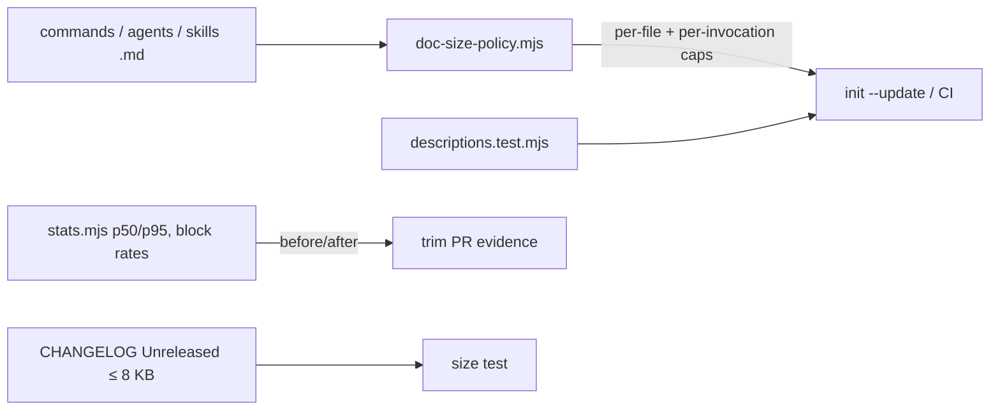

> **Human reference.** The loop never reads this file. What it enforces lives in
> [`slim.rules.md`](./slim.rules.md); if the two disagree, the rules file wins
> and `/architect --update slim` should be run.

# Slimness architecture
_Last verified: 2026-10-18 at `ac57d0e` · Source idea: [feature-branch-plans](../ideas/feature-branch-plans.md)_

## In plain English
Every craftsman file must be as small as it can be without losing capability.
This is a design requirement, not a style preference. The prose the model reads
is capped two ways:
- per file;
- per invocation: a command plus every shared doc it always loads.

Caps only ever go down. Adding prose means compressing something else in the
same change. Scripts cost no context, so they are budgeted by hook latency, with
a CI warning when they grow. "Without losing performance" means no gate gets
weaker, no asserted phrase is lost, and block rates don't fall.

## How it fits

## Decisions
| id | decision | why | rejected alternatives |
|---|---|---|---|
| ARCH-SLIM-01 | Every loadable .md is capped | Unpoliced files (skill references) grow silently | Cap only some categories |
| ARCH-SLIM-02 | Ratchet | Operationalises "as slim as possible" without a big-bang rewrite | Lower fixed caps now; review only |
| ARCH-SLIM-03 | Per-invocation cap | Context cost is per invocation, not per file | Per-file only; token-based (needs a tokenizer) |
| ARCH-SLIM-04 | Conditional reference docs | An existing pattern (`_shared-execution`, `_architecture`) | Inline everything |
| ARCH-SLIM-05 | Delete what's enforced; dedupe only into already-loaded docs | Moving text into a newly loaded doc raises load | Move all to shared docs |
| ARCH-SLIM-06 | MUST sentences leave only with mechanical backing | Keeps gate strength | Trim freely |
| ARCH-SLIM-07 | Scripts: soft size warning, hard latency budget | Scripts cost no tokens; latency is what users feel | Hard per-file caps; latency only |
| ARCH-SLIM-08 | CHANGELOG `[Unreleased]` ≤ 8 KB, cut 2.2.0 | `/idea` reads it every run (31.5 KB today) | `/idea` reads bullet heads only |
| ARCH-SLIM-09 | New behaviour is a role, not a new agent | The descriptions budget is shared | New agents freely |

## Trade-offs & known limits
"No lost performance" can only be shown as "no gate weakened, no asserted
phrase lost, block rates not down". A prose trim can still shift model
behaviour in ways no test sees. The ratchet will cause friction on the five
files that are already at their caps.

## Glossary
- **Per-invocation load:** a command's bytes plus every shared doc it reads unconditionally.
- **Ratchet:** a cap that can only go down.

## Slim amendments (2026-10-23)
ARCH-SLIM-10 measures always-loaded bytes: a 3 KB SessionStart target and a per-session "baseline" context sample, so start-up cost and growth can be told apart. ARCH-SLIM-11 borrows Superpowers' patterns (TDD, systematic debugging, verification before completion, a tiny bootstrap) as vendored, attributed skills, with no dependency. ARCH-SLIM-12 limits the model-invocable surface to ten entry points; other commands become internal and are deleted only after 30 idle days. See [approval](./approval.md).
