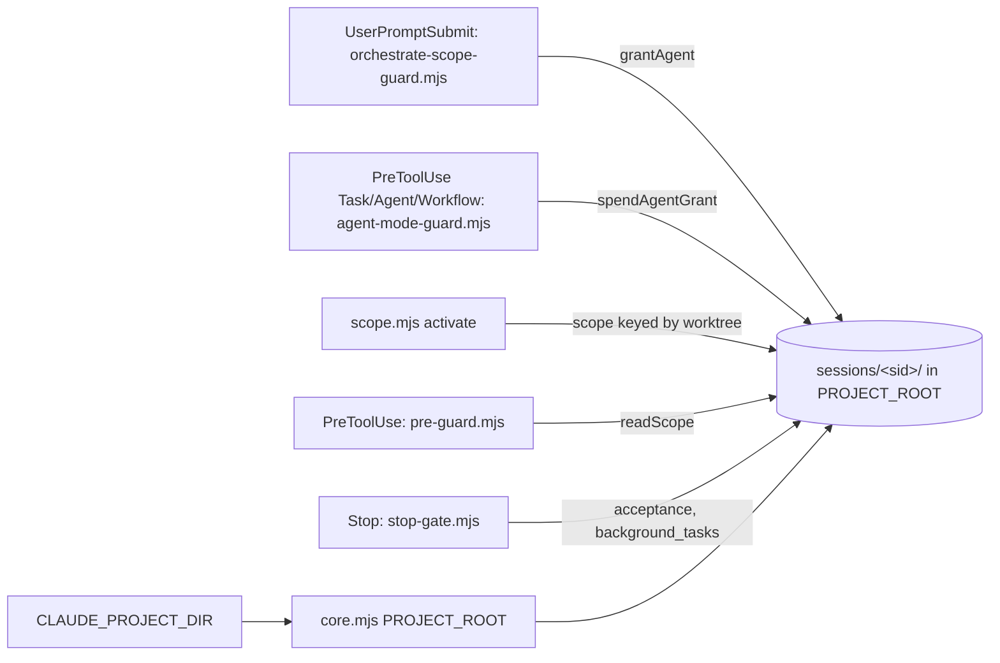
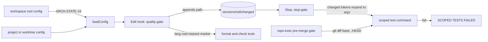

> **Human reference.** The loop never reads this file. What it enforces lives in
> [`state.rules.md`](./state.rules.md); if the two disagree, the rules file wins
> and `/architect --update state` should be run.

# State architecture
_Last verified: 2026-11-03 at `a0cb8a2` · Source idea: [autonomous-e2e-loop](../ideas/autonomous-e2e-loop.md)_

## In plain English
Craftsman's guards keep their state under `.craftsman/sessions/<session-id>/`.
That state includes one-shot agent grants, the active scope, doc-write
authority and acceptance ownership. One hook writes a piece of state and
another hook reads it later, so both must agree on **which `.craftsman/`
folder** to use.

Today the folder follows the shell's current directory. On 2026-10-09 a
grant was written to the parent folder and checked in the repo's folder,
which blocked a legitimate dispatch. This area pins the root to what the
harness declares (`CLAUDE_PROJECT_DIR`). It also makes state safe for the
agents an autonomous run spawns. Those agents share the root's session id, so
anything per-unit is keyed by the unit's worktree instead.

## How it fits

## Decisions
| id | decision | why | rejected alternatives |
|---|---|---|---|
| ARCH-STATE-01 | Root comes from `CLAUDE_PROJECT_DIR`, never from the working directory | It's the only input every hook and script shares that can't change mid-session | Session pin file (scripts have no session id, so concurrent sessions race); "outermost candidate" (still depends on the working directory) |
| ARCH-STATE-02 | A grant's writer and spender use the same inputs | Root cause of the observed block | — |
| ARCH-STATE-03 | Per-unit scope is keyed by worktree | Agents share `session_id`; every unit already owns one worktree | Agent-id keyed (an agent can't learn its own id); sequential-only (blocks parallel waves forever) |
| ARCH-STATE-04 | The stop gate defers only the acceptance block while background work runs | Mirrors `/goal`'s own deferral; avoids the 8-block cap | Adopt acceptance ownership only in Phase C (leaves the run unguarded); rely on the cap (known failure, see CHANGELOG) |
| ARCH-STATE-05 | `Workflow` is guarded like `Task`/`Agent` | Otherwise "use a workflow" bypasses agent mode | Rely on the runtime's consent prompt |
| ARCH-STATE-06 | Sub-project grants live in the root project's session dir | Hook input has no project field | Guessing the project from the working directory (re-introduces the root split) |
| ARCH-STATE-07 | No `SubagentStop` hook | Per-unit completion is already enforced by `tracker.mjs` | Gating each agent's stop (duplicate enforcement) |
| ARCH-STATE-08 | Stop blocks while an owned feature waits to land | Anthropic's premature-victory failure mode | Rely on prose |

## Data & flows
Grants are one-shot files that are renamed and then unlinked when spent.
Scope files are JSON. Per-unit scopes sit beside the session scope, keyed by
a hash of the worktree path. `readScope` already picks the scope whose
worktree contains the target file.

## Trade-offs & known limits
Opening Claude Code one level above a repo now requires
`/craftsman:workspace-init`. Without it, state and config fall back to the
parent folder and the plugin defaults. The analyst also found that the
pre-guard git check uses `process.cwd()`, and it is unproven whether that
matches an agent's shell; the spike checks it.

## Glossary
- **Grant**: a one-shot permission file that lets a single isolated agent
  dispatch run.
- **sid**: the session id from hook input.
- **Spike**: the 1-unit proof run required by ARCH-ENGINE-02.

## Plan-hierarchy additions (2026-10-18)
ARCH-STATE-09: scope stays keyed by worktree; the next unit replaces and every exit releases. See [plan](./plan.md) for the reasoning and rejected alternatives.

## Flow amendments (2026-10-23)
ARCH-STATE-12 narrows the 18 Oct fail-closed choice, with the owner's approval. A command the parser cannot read is refused only if it also names a guarded path, or a git commit or push outside a heredoc. Everything else is allowed, logged, and listed weekly for review. Evidence: 29 harmless Gleam blocks in 1.5 days. The architect session writing these rules was itself blocked because a heredoc body mentioned a hook-bypass flag. ARCH-STATE-13 names the three lines never crossed mid-run: secrets, deletes outside the worktree, and publication. See [approval](./approval.md).

## Amendments (2026-10-23, owner-approved)

- **ARCH-STATE-14** replaces 12: the guard's removal-word refusal stays fail-closed as PR #1 built it. Only two things change: heredoc prose is not a hook-bypass flag unless the heredoc feeds a shell or interpreter, and a lease push to the run's own branches is allowed. `guard_unparsed` is not emitted.
- **ARCH-STATE-15** replaces 13: outside-worktree deletes and credential reads are the Claude Code sandbox's job (ARCH-SAFETY-01), not pre-guard's. Craftsman keeps `protectedPaths` for env files and the stop-gate secrets scan, and publication still waits for approval. Nothing PARKs on a secret hit today; the guard exits 2 with the fix.
- **ARCH-STATE-16** replaces 14 (after review round 8): the heredoc-prose allowance is dropped. The hook-bypass check reads the whole command as PR #1 built it, so prose that mentions the flag inside a heredoc is refused; only the own-branch `--force-with-lease` allowance remains.

## Amendments (2026-11-01, owner-approved)

- **ARCH-STATE-17** replaces 10: the same state-resolution rule, plus one allowance. Under an active unit scope the `Read` tool (never Glob, Grep or a write) may read a file whose real path is under the OS temp dir or `$CLAUDE_JOB_DIR/tmp`. It passes the scope check and the ambiguous-scope refusal, but `protectedPaths` still apply, and a symlink or `..` is judged by where it leads. Why: models read evidence (screenshots, logs) there while verifying a unit, and the project-boundary check refused every such Read: 32 of them in the 2026-11-01 sweep with the misleading "more than one active project scope". Rejected: keeping it fail-closed (the manifest cannot list a path outside the project as a relative entry), and allowing any Read outside every git repo (credential reads would then rest entirely on the sandbox and deny rules, ARCH-SAFETY-01). Not covered, on purpose: a Read when no scope is active ("requires an active unit scope"), directories such as `~/scratch`, and Claude Code's own tool-result spill files.

## Phase 2 amendments (2026-11-01, owner-approved)
_Verified at `a0cb8a2`. Source: [sandbox-auto-flow](../plans/sandbox-auto-flow.md) phase 2; `/idea` was skipped. The full table and diagram are in [safety.md](./safety.md#phase-2-amendments-2026-11-01-owner-approved)._

**Status: implemented (2026-11-03).** ARCH-STATE-18 covers Write and Edit as well as Read. A scoped Write may create a scratch file (judged by its nearest existing ancestor, a `..` in the missing part refused), and a Write or Edit target with more than one hard link is refused.

- **ARCH-STATE-18** replaces 17: Write and Edit join Read for files whose real path is under the OS temp dir or `$CLAUDE_JOB_DIR/tmp`. NotebookEdit, Glob and Grep stay refused, an enclosing root still rules a directory out, and `protectedPaths` still apply. A new file is judged by its nearest existing ancestor, and an existing target with more than one hard link is refused, because a link can carry a write to protected state. Why: under a scope, this `/architect` run couldn't write a probe script to the job dir and had to put one in the repo root, while ARCH-SAFETY-01 already leaves outside-root writes to the sandbox. Rejected: keeping Read only, which means scratch scripts end up in the repo.
- Two other decisions from this pass touch state but live elsewhere. The scope-required marker's lifetime is **ARCH-AUTO-11** ([auto.md](./auto.md)), and the command-record lifetime is part of **ARCH-SAFETY-13** ([safety.md](./safety.md)). They moved there so unit contexts that load `state.rules.md` stay inside the ARCH-ENGINE-08 budget.

## Service-scoped gates (2026-11-03)
Source: [service-scoped-gates](../ideas/service-scoped-gates.md). Rules ARCH-STATE-19 to 22, plus ARCH-LAND-37 in [landing](./landing.md). A multi-service workspace such as Gleam (61 submodules, one repo per service) used to get one config, one tool cwd and one whole-repo test command. These four rules let each service use the workspace's settings, run tools in the right folder and test only what a session touched.

| id | decision | why | rejected alternatives |
|---|---|---|---|
| ARCH-STATE-19 | A sub-project or unit worktree inherits the workspace root's config, with `{workspaceRoot}` for root-relative commands | Units were getting plugin defaults (csharp `dotnet format`, no `extraChecks`) because their root has no config; Gleam edits 3 lines | Opt-in `workspace.inheritConfig` (leaves the gap open); inherit non-command keys only (a root `stopGate` edit would not apply in units) |
| ARCH-STATE-20 | `languages.<lang>.cwd = "nearest:<marker,...>"`, resolved downward from the file, never above root | One block serves all 61 services; deletes Gleam's ESLint wrapper | Static path per service (a per-repo list again); tool flags only (does not put `eslint` on PATH) |
| ARCH-STATE-21 | `{changed}` / `{changedDirs}` whole-token placeholders from the session change list; never snapshotted; failure blocks as scoped | A snapshot cannot know the touched set at session start; `git status` would test other sessions' dirt | `git status` source; advisory-only failure |
| ARCH-STATE-22 | Events carry `project` and a fixed skip-reason set | The idea's own kill test needed a count of dirty stops that ran nothing | One event per skipped command |

**Correction to the idea.** An empty `stopGate.commands: {}` does not disable the defaults: `deepMerge` keeps every default key (`scripts/lib/core.mjs:590`), so Gleam's whole-solution `dotnet test` runs at every session start and is red, which is why Stop never runs a test. Only a `null` value drops a marker (`scripts/lib/gate-command.mjs:30`). Gleam's own stop events show about 65 dirty stops in 3 days with no test run.

**Trade-offs.** Inheriting by default is the only behaviour change; it is called out under "Changed" in the CHANGELOG and shipped last, after Gleam's three root-relative commands use `{workspaceRoot}`. The session change list is blind to edits made only through Bash, as the `dirty` marker already is. A scoped failure in a service that was already red blocks until it is fixed or the marker is set to `null`. Deferred: resolving every file to its owning service and running an affected-set engine (idea recommendation 5).

**Glossary.** *Change list*: root-relative paths the session edited, one per line, in `sessions/<sid>/changed`. *Scoped command*: a test or check command containing `{changed}` or `{changedDirs}`.

## Review fixes to the scoped gates (2026-11-04)
The isolated review of the first implementation found and fixed (plan [scrutinise-service-scoped-gates](../plans/scrutinise-service-scoped-gates.md)): a scoped command whose marker lives only in a sub-directory now runs at Stop (it is selected the way the session snapshot selects), a file deleted after an edit drops out of the Stop set instead of blocking every later Stop, an embedded placeholder (`--files={changed}`) is never snapshotted and is said once, a path starting with `-` is handed to the tool as `./-...`, and a `null` language entry from layering no longer crashes the quality gate. The wording of ARCH-STATE-21 gained the gone-path and embedded cases; ARCH-STATE-19 to 22 now name the test files that actually hold their cases (`config-layering`, `tool-cwd`, `stop-gate-scoped`, `stop-gate-skip-reasons`, `quality-gate-events`).
