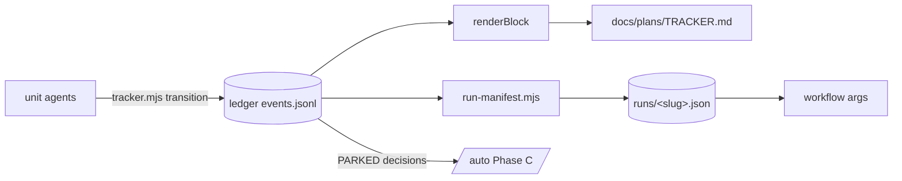

> **Human reference.** The loop never reads this file. What it enforces lives in
> [`tracker.rules.md`](./tracker.rules.md); if the two disagree, the rules file wins
> and `/architect --update tracker` should be run.

# Tracker architecture
_Last verified: 2026-10-18 at `ac57d0e` · Source idea: [autonomous-e2e-loop](../ideas/autonomous-e2e-loop.md)_

## In plain English
The tracker already works much like Anthropic's "feature list". It is an
append-only JSON ledger (`.craftsman/tracker/events.jsonl`) with enforced
status transitions. `docs/plans/TRACKER.md` is generated from it. The
autonomous loop adds:
- a derived per-run manifest (`.craftsman/runs/<slug>.json`) that the workflow
  takes as input;
- a structured `decision` on parked rows;
- two rules: a run can't cancel rows to look finished, and each unit runs a
  smoke test before editing.

## How it fits

## Decisions
| id | decision | why | rejected alternatives |
|---|---|---|---|
| ARCH-TRACKER-01 | The run manifest is derived from the ledger | Keeps every existing consumer working | Replace TRACKER.md with JSON (breaks pre-guard, tracker-sync and history) |
| ARCH-TRACKER-02 | Changes to event fields are additive only | Consumers spread `...event` | — |
| ARCH-TRACKER-03 | Structured `decision` on PARKED | Phase C is assembled mechanically | Free-text evidence |
| ARCH-TRACKER-04 | Autonomous runs can't emit CANCELLED | Stops a run declaring done early (Anthropic's harness findings) | — |
| ARCH-TRACKER-05 | Smoke test first | Catches breakage left by the previous unit | — |
| ARCH-TRACKER-06 | New `FEATURE_MERGED` status; COMPLETE only via land-feature | Hooks read status alone, so a flag would let them treat a unit as landed early | `MERGED` + `feature_landed` flag |
| ARCH-TRACKER-07 | Additive `feature`/`feature_branch` fields; manifest adds `feature_groups` | `features[]` already means units (TRACKER-01 consumers) | Rename `features[]` |
| ARCH-TRACKER-08 | `[feature:<id>]` criteria gate a feature's landing | User decision: explicit per-feature definition of done | Untagged lines gate only the last feature |
| ARCH-TRACKER-09 | Machine-readable archive headings + `lookup` | A retired plan is reachable only through its index line | A separate index file |
| ARCH-TRACKER-15 | Whole-plan criteria carry `[plan:<slug>]`; they hold only their own plan's promotion and land-feature | One shared acceptance file holds many plans; an untagged line from one plan held every plan's rows (2026-10-27) | Attribute by section header (lines land under foreign headers); tag to the plan's last unit (gates MERGED, not the plan) |
| ARCH-TRACKER-16 | Stop holds a session only to the units and plans its ledger names; untagged lines bind only plan-less sessions, otherwise appear in the Stop notice | A goal for one plan was blocked 9 times on another plan's untagged criterion (2026-10-27) | Notice only, never bind (loses a single-plan repo's gate); keep binding every owner (status quo) |

## Trade-offs & known limits
The manifest is a cache, so a crash between a transition and regeneration
leaves it stale. It is regenerated on the next transition or read.

## Plan-hierarchy additions (2026-10-18)
ARCH-TRACKER-10..12: generated epic/story rollups, `tracker publish` (the only path that commits progress to base) and the `TRACKER.jsonl` snapshot with refuse-to-blank. See [plan](./plan.md) for the reasoning and rejected alternatives.

## Partial-ledger amendments (2026-10-23)
ARCH-TRACKER-12 → 13: publish refuses to drop *any* committed row key without an archive event, not only a shrink to empty. Loost showed why: 5 local rows against 50 committed would have published silently. Repair is by name (`init --merge`), never a silent union, which could resurrect rows archived on another machine. ARCH-TRACKER-14: `init --from-block` rebuilds a ledger from the committed table when no `TRACKER.jsonl` exists (Loost); it is lossy on long evidence by design. This lands on main before PR #1 is rebased. See [approval](./approval.md).
