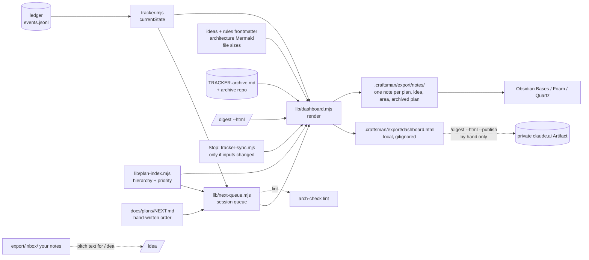

> **Human reference.** The loop never reads this file. What it enforces lives in
> [`views.rules.md`](./views.rules.md); if the two disagree, the rules file wins
> and `/architect --update views` should be run.

# Views architecture
_Last verified: 2026-10-23 at `7dc6c59` · Source idea: [external-project-board](../ideas/external-project-board.md)_

## In plain English
Craftsman writes a lot of markdown, and it is hard to scan. The views area gives you two ways to look at it without opening long files, both generated from what Craftsman already records:

1. **A visual page** you can scroll: plans as a board by status, your planned sessions, ideas grouped by verdict, a map of the architecture areas with their diagrams, the plan tree, a size bar for every doc, and an Archive tab.
2. **A folder of notes for other tools.** One short note per plan, idea, architecture area and archived plan, each with its status, progress and priority written as frontmatter. Open that folder in **Obsidian** and its Bases give you a board, table or cards; **Foam** and **Quartz** add graph views. It is open to any tool that reads markdown with frontmatter. Notes you drop into its `inbox/` folder become the starting text for `/idea`. Nothing else flows back.

Both live in `.craftsman/export/` inside each repo, are never committed, and are rebuilt for you.

The page is generated from what Craftsman already records. It never becomes a second tracker: status still comes from the ledger. The one thing you write by hand is `docs/plans/NEXT.md`, an ordered list of the plans you mean to work on next and a line on why. The page is a local file. It refreshes when you ask (`/digest --html`) and quietly at the end of each session if anything changed. You can publish it as a private claude.ai page by hand to open it on your phone.

## How it fits


## Decisions
| id | decision | why | rejected alternatives |
|---|---|---|---|
| ARCH-VIEWS-11 (was 01) | Read-only, derived from existing data | The ledger stays the one source of status (ARCH-TRACKER-01); a view cannot drift if it owns nothing | GitHub Projects mirror (second status store, needs `project` token scope, GitHub-only); Backlog.md (a second task writer) |
| ARCH-VIEWS-11 (was 02) | One local export tree in `.craftsman/export/`: the HTML page, a notes folder and an inbox | Your choice: no merge noise, no doc-guard friction, nothing leaves the machine; opens from `file://` | Committed `docs/DASHBOARD.html` (GitHub shows HTML as source; every regen is a diff); both |
| ARCH-VIEWS-11 (was 02) | Mermaid from a pinned CDN, source shown offline | Your choice: keeps the file around 100 KB | Inline mermaid.js (2–3 MB per file); links only (least visual) |
| ARCH-VIEWS-15 (was 03) | Seven sections (the six plus Archive), no doc bodies | Your choice of views; bodies would make a 400 KB plans folder into a heavy page | A docs site (Quartz, mdBook) that renders bodies but has no ledger board |
| ARCH-VIEWS-04 | This repo only | Your choice: simplest; run it per repo | Workspace-aware page across every registered project |
| ARCH-VIEWS-05 | On demand plus at Stop, skipped when unchanged | Your choice: always current after a session; the fingerprint keeps hook latency near zero on no-op stops | On demand only; on every tracker write (most churn and latency) |
| ARCH-VIEWS-06 | `docs/plans/NEXT.md`, committed, order and intent only | Your choice: travels with git across machines; no status text so it cannot contradict the ledger | Local `.craftsman/next.json` (lost on a new machine); computed only (no way to pin your order) |
| ARCH-VIEWS-07 | Your order first, then a computed ready list | Planning ahead is ordering, not dates; fills the queue slot ARCH-PLAN-05 reserves | Dated timeline (Markwhen): needs dates you do not plan by |
| ARCH-VIEWS-08 | Publish only by hand with `--publish` | Your choice: phone access when you want it; plan titles name private repos, so never automatic | Never publish; publish from Stop |
| ARCH-VIEWS-09 | Logic in scripts, minimal command prose | Command bytes are capped and ratchet (ARCH-SLIM-01/02); scripts are not | New `/dashboard` command (a new entry point and new capped bytes) |
| ARCH-VIEWS-10 | Two events, latency in stats | Shows whether the Stop render costs anything | No telemetry |
| ARCH-VIEWS-12 | A notes folder with one frontmatter note per plan, idea, area and archived plan | Your ask for other tools: Obsidian Bases groups on a note property (`status`), and plan status lives only in the ledger, so without generated notes no off-the-shelf tool can board your plans | Pointing a viewer at `docs/` directly (ideas board, plans cannot); a Backlog.md export (its file schema is undocumented, so it needs a spike) |
| ARCH-VIEWS-13 | Notes regenerate with the page; only generated files are ever removed | Keeps the folder honest and safe to share with a tool that also writes there | Hand-maintained notes |
| ARCH-VIEWS-14 | `inbox/` is yours; a note there seeds `/idea`; nothing else flows back | Your choice: capture ideas from the tool you are browsing in, while status and order stay owned by the ledger and `NEXT.md` | Strictly one-way; writing status and order back (a second writer) |
| ARCH-DOCS-13 | `NEXT.md` is never a referrer; prose mentions of an archived plan are rewritten after a confirmed dry run | Supersedes the earlier ARCH-DOCS-12; see [archive](./archive.md) | Keep refusing every referrer |

## Data & flows
- **Owned (generated, local):** everything under `.craftsman/export/`: `dashboard.html`, `notes/…`, and `dashboard.url` when you have published. `inbox/` inside it is yours and is never touched.
- **Owned (committed, hand-written):** `docs/plans/NEXT.md`.
- **Read, never written:** the ledger, plan and idea frontmatter, rules frontmatter, architecture Mermaid blocks, file sizes, `TRACKER-archive.md`.
- **Example plan note:** `notes/plans/plan-hierarchy.md` has `type: plan`, `status: MERGED`, `progress: 78`, `priority: P1`, `parent:`, `goal:` and `source: docs/plans/plan-hierarchy.md`, and a body of the goal line and the source path.
- **NEXT.md shape:**
  ```markdown
  # Next sessions

  1. plan-hierarchy — finish story 2 rollups
  2. token-efficiency — measure baseline first
  ```
- **Consistency:** NEXT.md holds no status. The page shows each entry's state from the ledger, so a finished plan appears as finished even before you delete its line; lint then nudges you, and retirement removes it (ARCH-DOCS-12).

## Trade-offs & known limits
- Status on the page is only as fresh as the last render. It refreshes at Stop and on demand, not live.
- Mermaid needs the browser online the first time; offline you see the diagram source.
- One repo per page and per notes folder (your choice: each repo's `.craftsman/export/`). Opening several of them as one Obsidian vault is possible by hand; a shared export folder was not chosen. The archive repo is the cross-project view of finished work.
- The notes carry status, never doc bodies. To read a doc you open its `source` path; these tools are for finding and grouping, not for reading.
- Plans store no status in frontmatter. That is why the notes folder exists: it copies the ledger's status into each generated note so Obsidian Bases, Foam and Quartz can group plans. Obsidian is free but not open source; Foam and Quartz are MIT. Whether Obsidian's graph follows plain markdown links, and whether Quartz renders Mermaid, were not confirmed and need a short check at build time.
- Publishing copies plan titles and goals to claude.ai. It is manual for that reason.

## Glossary
- **Dashboard:** the generated `.craftsman/dashboard.html`.
- **Session queue:** NEXT.md entries in your order, then the computed ready list.
- **Lane:** one of the first `execution.maxSessions` queue entries, meant to run in parallel sessions.
- **Fingerprint:** mtimes and sizes of the dashboard's inputs, compared at Stop to skip a no-op render.
