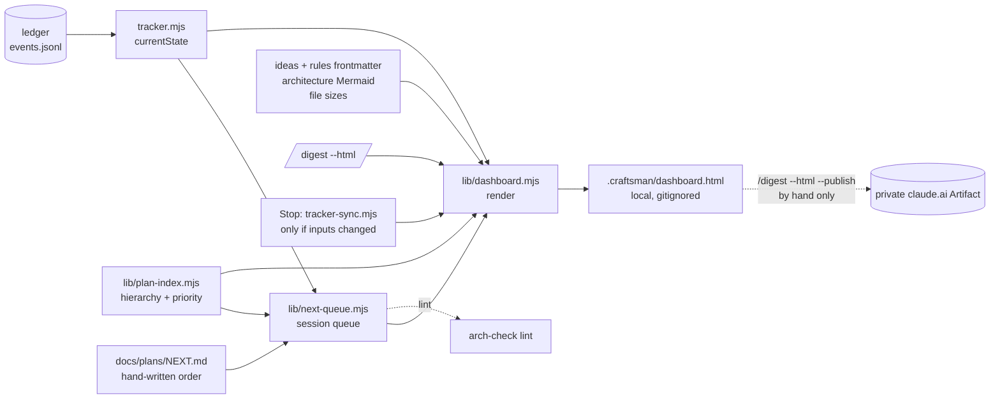

> **Human reference.** The loop never reads this file. What it enforces lives in
> [`views.rules.md`](./views.rules.md); if the two disagree, the rules file wins
> and `/architect --update views` should be run.

# Views architecture
_Last verified: 2026-10-23 at `7dc6c59` · Source idea: [external-project-board](../ideas/external-project-board.md)_

## In plain English
Craftsman writes a lot of markdown, and it is hard to scan. The views area adds one visual page you can scroll: plans as a board by status, your planned sessions, ideas grouped by verdict, a map of the architecture areas with their diagrams, the plan tree, and a size bar for every doc so the heavy ones stand out.

The page is generated from what Craftsman already records. It never becomes a second tracker: status still comes from the ledger. The one thing you write by hand is `docs/plans/NEXT.md`, an ordered list of the plans you mean to work on next and a line on why. The page is a local file. It refreshes when you ask (`/digest --html`) and quietly at the end of each session if anything changed. You can publish it as a private claude.ai page by hand to open it on your phone.

## How it fits


## Decisions
| id | decision | why | rejected alternatives |
|---|---|---|---|
| ARCH-VIEWS-01 | Read-only, derived from existing data | The ledger stays the one source of status (ARCH-TRACKER-01); a view cannot drift if it owns nothing | GitHub Projects mirror (second status store, needs `project` token scope, GitHub-only); Backlog.md (a second task writer) |
| ARCH-VIEWS-02 | One local self-contained HTML in `.craftsman/` | Your choice: no merge noise, no doc-guard friction, nothing leaves the machine; opens from `file://` | Committed `docs/DASHBOARD.html` (GitHub shows HTML as source; every regen is a diff); both |
| ARCH-VIEWS-02 | Mermaid from a pinned CDN, source shown offline | Your choice: keeps the file around 100 KB | Inline mermaid.js (2–3 MB per file); links only (least visual) |
| ARCH-VIEWS-03 | All six sections in v1, no doc bodies | Your choice of views; bodies would make a 400 KB plans folder into a heavy page | A docs site (Quartz, mdBook) that renders bodies but has no ledger board |
| ARCH-VIEWS-04 | This repo only | Your choice: simplest; run it per repo | Workspace-aware page across every registered project |
| ARCH-VIEWS-05 | On demand plus at Stop, skipped when unchanged | Your choice: always current after a session; the fingerprint keeps hook latency near zero on no-op stops | On demand only; on every tracker write (most churn and latency) |
| ARCH-VIEWS-06 | `docs/plans/NEXT.md`, committed, order and intent only | Your choice: travels with git across machines; no status text so it cannot contradict the ledger | Local `.craftsman/next.json` (lost on a new machine); computed only (no way to pin your order) |
| ARCH-VIEWS-07 | Your order first, then a computed ready list | Planning ahead is ordering, not dates; fills the queue slot ARCH-PLAN-05 reserves | Dated timeline (Markwhen): needs dates you do not plan by |
| ARCH-VIEWS-08 | Publish only by hand with `--publish` | Your choice: phone access when you want it; plan titles name private repos, so never automatic | Never publish; publish from Stop |
| ARCH-VIEWS-09 | Logic in scripts, minimal command prose | Command bytes are capped and ratchet (ARCH-SLIM-01/02); scripts are not | New `/dashboard` command (a new entry point and new capped bytes) |
| ARCH-VIEWS-10 | Two events, latency in stats | Shows whether the Stop render costs anything | No telemetry |
| ARCH-DOCS-12 | `NEXT.md` is not a retirement referrer; retiring removes its line | Your amendment: otherwise any planned plan blocks its own retirement (`doc-retire.mjs:35-37` greps every `docs/**` file) | Keep ARCH-DOCS-02 and delete the line by hand first |

## Data & flows
- **Owned:** `.craftsman/dashboard.html` and `.craftsman/dashboard.url` (local), and `docs/plans/NEXT.md` (committed, hand-written).
- **Read, never written:** the ledger, plan and idea frontmatter, rules frontmatter, architecture Mermaid blocks, file sizes.
- **NEXT.md shape:**
  ```markdown
  # Next sessions

  1. plan-hierarchy — finish story 2 rollups
  2. token-efficiency — measure baseline first
  ```
- **Consistency:** NEXT.md holds no status. The page shows each entry's state from the ledger, so a finished plan appears as finished even before you delete its line; lint then nudges you, and retirement removes it (ARCH-DOCS-12).

## Trade-offs & known limits
- Status on the page is only as fresh as the last render. It refreshes at Stop and on demand, not live.
- Mermaid needs the browser online the first time; offline you see the diagram source.
- One repo per page. A cross-repo view was rejected for now; the workspace manifest (`scripts/lib/core.mjs:104`) makes it a later, additive change.
- Plans store no status in frontmatter, so off-the-shelf viewers (Obsidian Bases, Foam) can show ideas but not the plans board. They remain fine for reading doc bodies.
- Publishing copies plan titles and goals to claude.ai. It is manual for that reason.

## Glossary
- **Dashboard:** the generated `.craftsman/dashboard.html`.
- **Session queue:** NEXT.md entries in your order, then the computed ready list.
- **Lane:** one of the first `execution.maxSessions` queue entries, meant to run in parallel sessions.
- **Fingerprint:** mtimes and sizes of the dashboard's inputs, compared at Stop to skip a no-op render.
